# DivanAI — many AI minds, one table

**Site:** https://divanai.github.io/  ·  **Source:** https://github.com/divanai/divanai.github.io  ·  **Bugs/suggestions:** https://github.com/divanai/divanai.github.io/issues

**English** · [Türkçe](README.md) — the interface is bilingual: flip it with the two flags in the top bar.

> **Divan** was the Ottoman council where state affairs were debated; the **AI** suffix carries it to
> artificial intelligence. Pronounced *di-va-na-i*. Correct spelling: **divanai** (one word, lower case).

You write a topic; the AI minds at the table speak in turn, challenge each other, and at the end the
chair sums it up. No tab-by-tab copy-paste.

**One file.** Double-click `index.html` and it opens. No install, no account, no server.
**Opens keyless (Demo).** The app starts in **Demo** mode: three seats on three separate free services
(OVH · LLM7 · Pollinations), no signup, no key. The answers are **real** — not canned text; the price is
slowness and the services' daily limits. **Live** mode **requires an API key**: your own key buys speed and
a higher limit; the live default table has **4 seats**.

| **Council** | **Panel** | **Mirror** | **Agents** | **OneOnOne** |
|---|---|---|---|---|
| Models from 3–5 different companies, roles, a chair summary | Seats answer **at once**, blind to each other; **the comparison is yours** | One model in two seats: defender + objector, judge verdict | A task per seat, chained hand-off, one delivery | A single AI, direct answer; the keyless option is **slow** |

If you just want a plain chat, pick **OneOnOne**: one AI at the table answers directly. A **keyless
option ships ready** (gpt-oss 20B, through Pollinations) — real answers with no signup; it is slow
(7 November 2026 measurement: **22 seconds** for the first answer, under a second when cached), so a proper test is better with a free key.

---

## Screenshots (current)

All shot from this build: 24 Oct 2026 · daytime "notebook" theme (night and mobile included).

| | | |
|---|---|---|
| 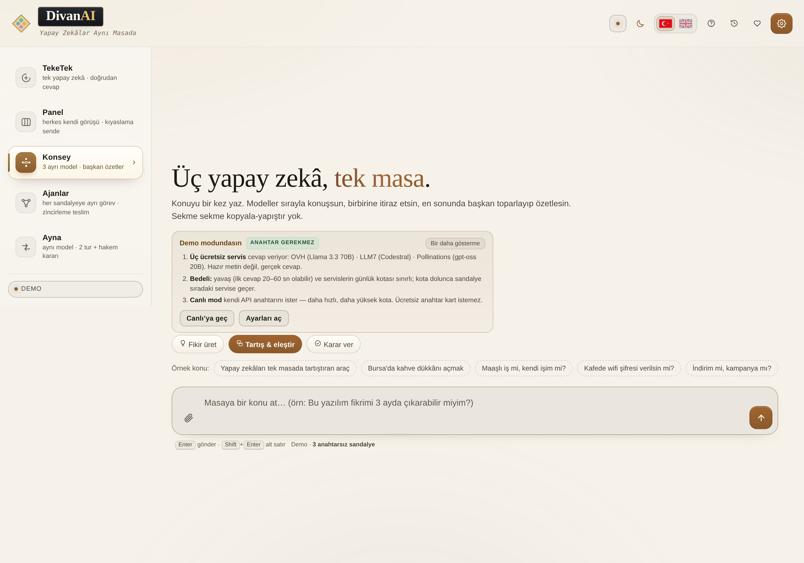 | 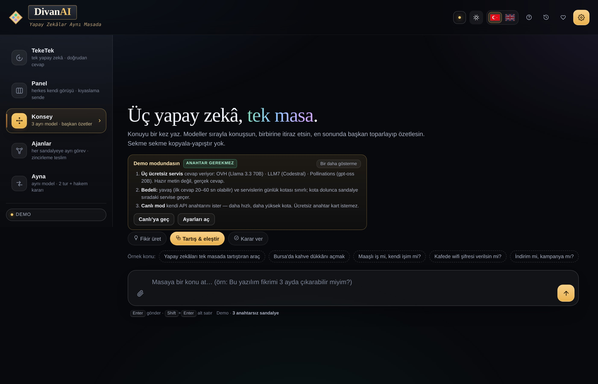 | 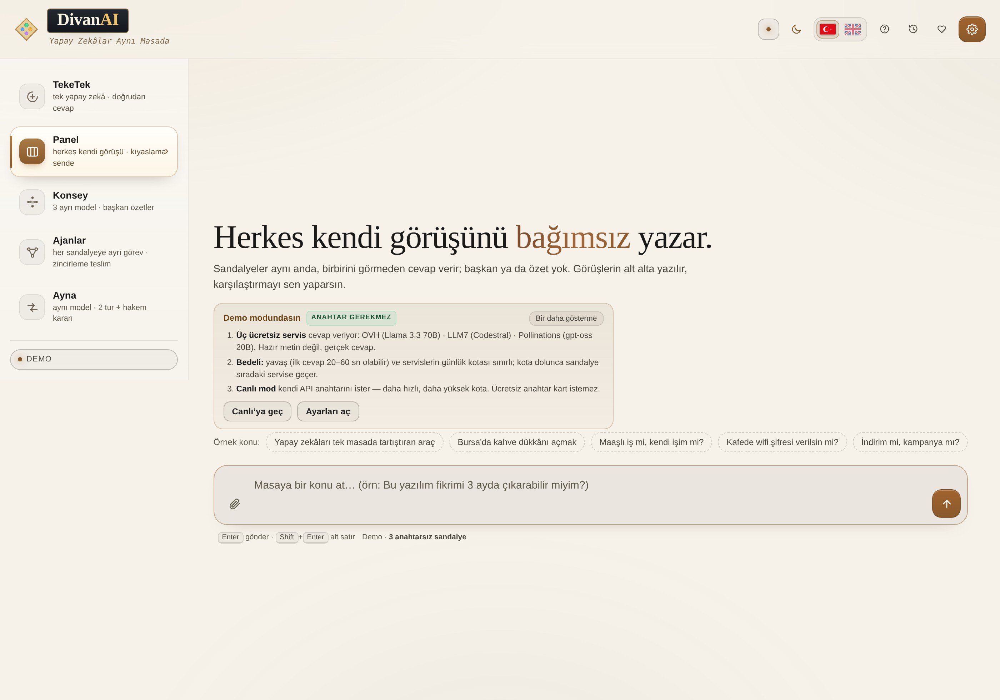 |
| **Home · daytime** | **Home · night** | **Panel — all at once, blind to each other** |
| 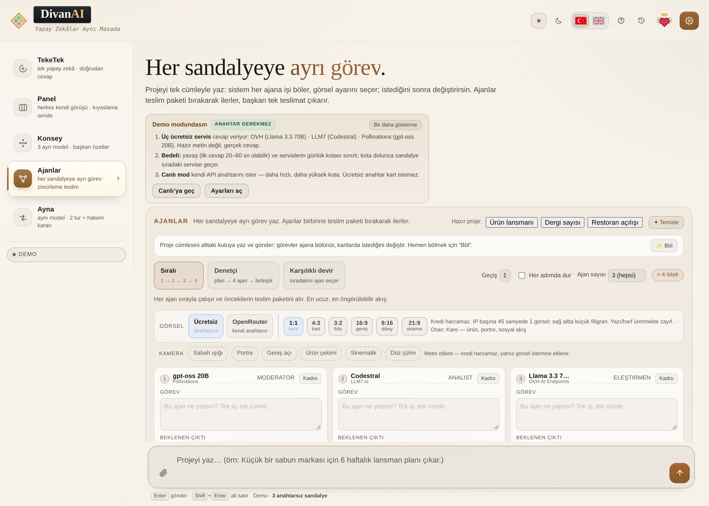 | 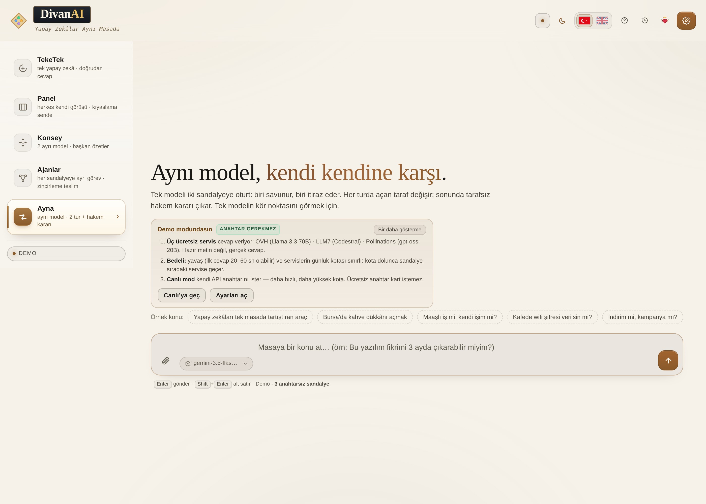 | 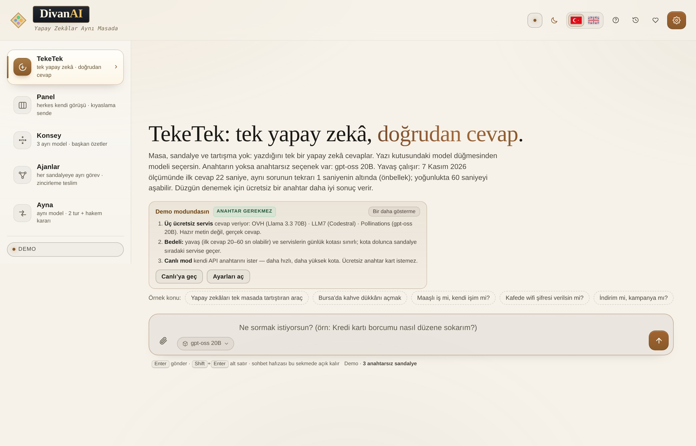 |
| **Agents — a task per seat** | **Mirror — same model, two sides** | **Single — one model, direct answer** |
| 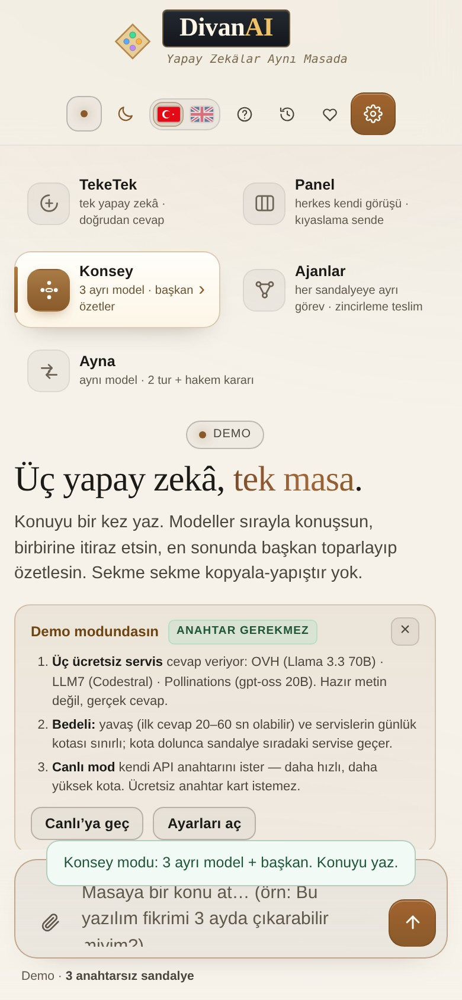 | 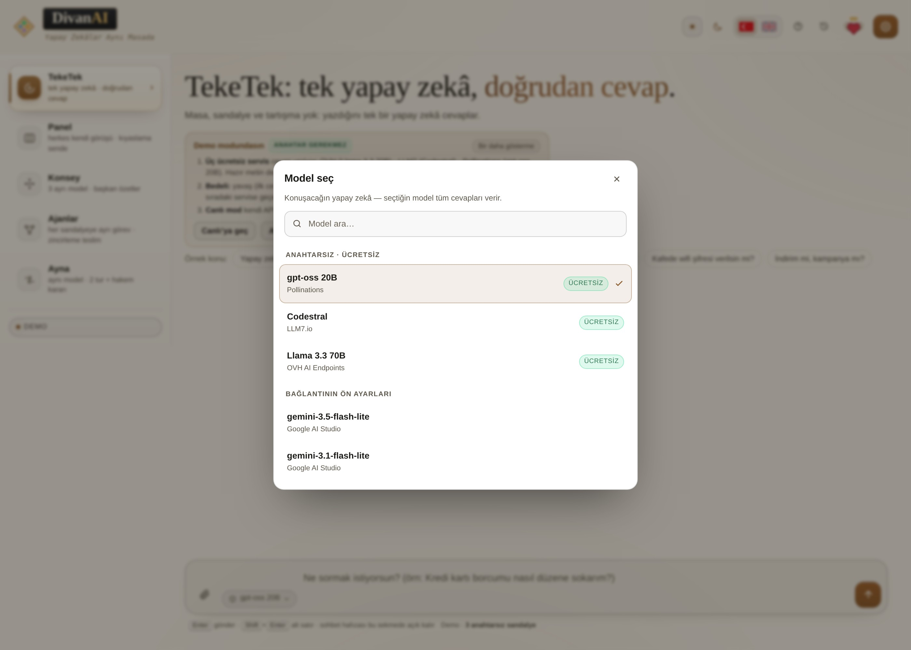 | 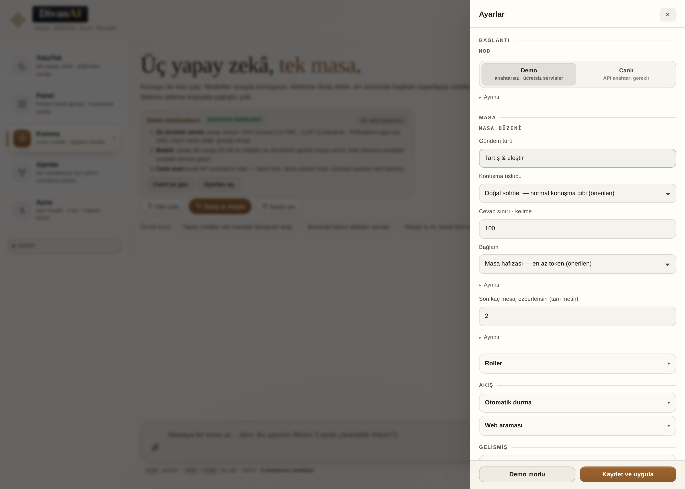 |
| **Phone** | **Model picker** | **Settings — grouped** |
| 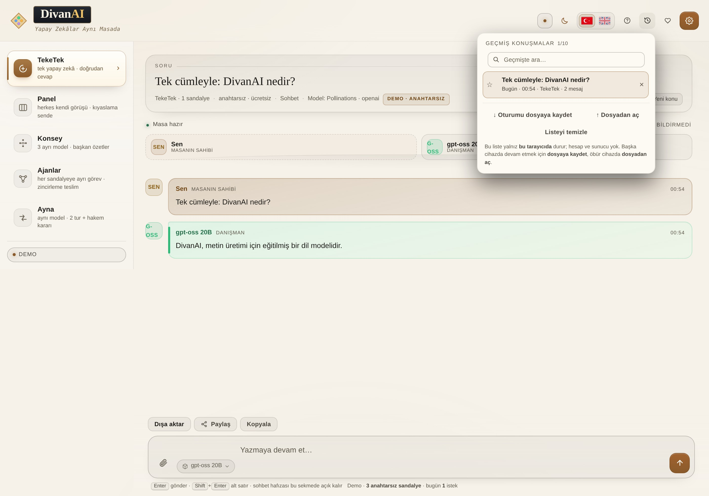 | 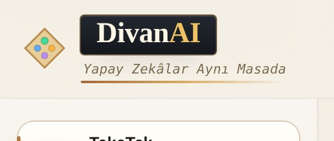 | 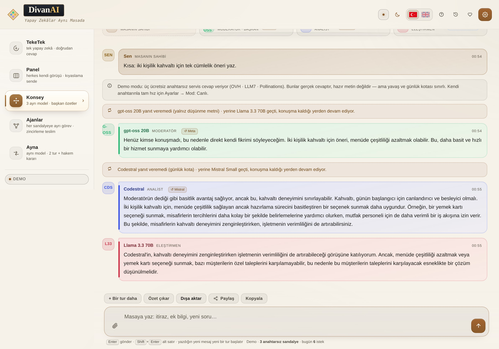 |
| **History search** | **Brand — brass line on hover** | **A real Council round: three models** |

### Live mode (with your own API key)

Live mode **requires your own key**; that is why these shots contain **no answers** — no key, no answer.
Everything visible is the real UI. The key in the shots is **sample text** (`TEST-0000-DENEME`) and is never sent anywhere.

| | | |
|---|---|---|
| 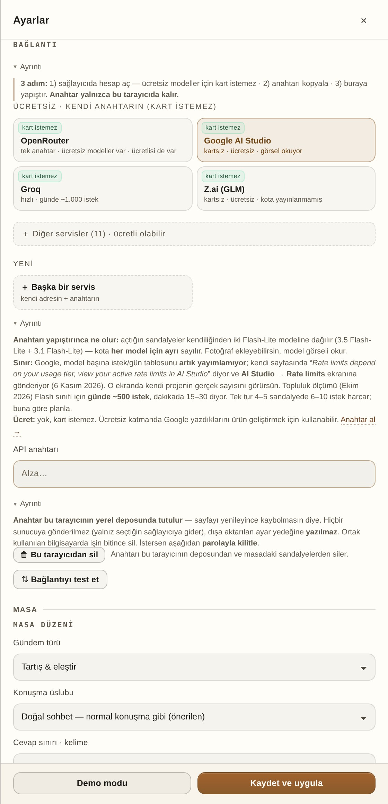 | 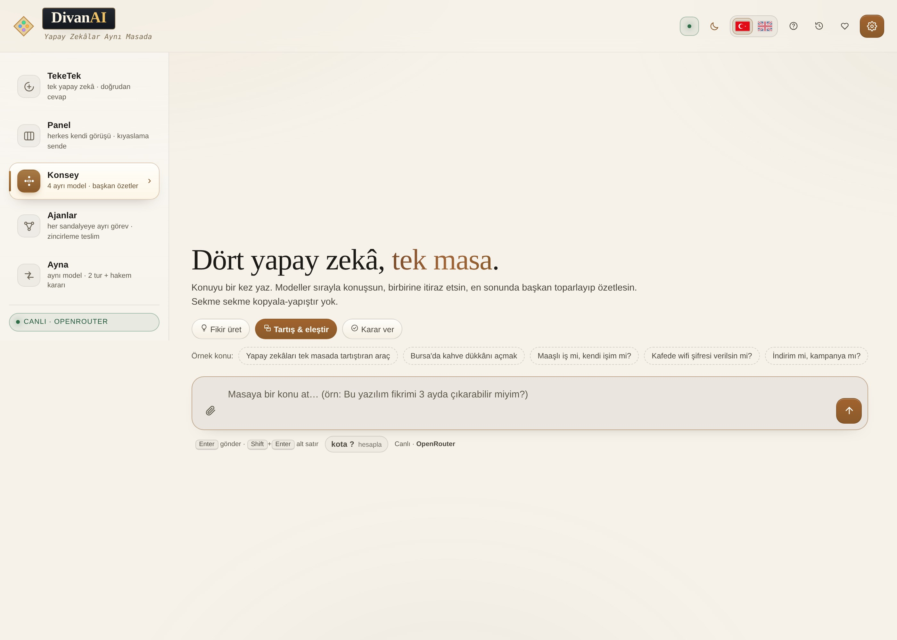 | 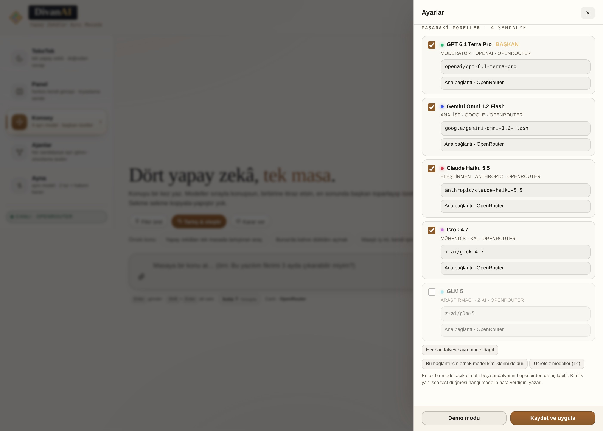 |
| **Connection — key field, free providers** | **Live table — 4 seats, "LIVE" badge** | **A separate model per seat** |

**What happens when you switch to Live:** the table grows to **4 seats** (ChatGPT · Gemini · Claude · Grok),
each seat gets **its own model**, and the model name is shown on the seat. Sample model ids are filled in
per provider; the "Spread a separate model to every seat" button re-deals them.

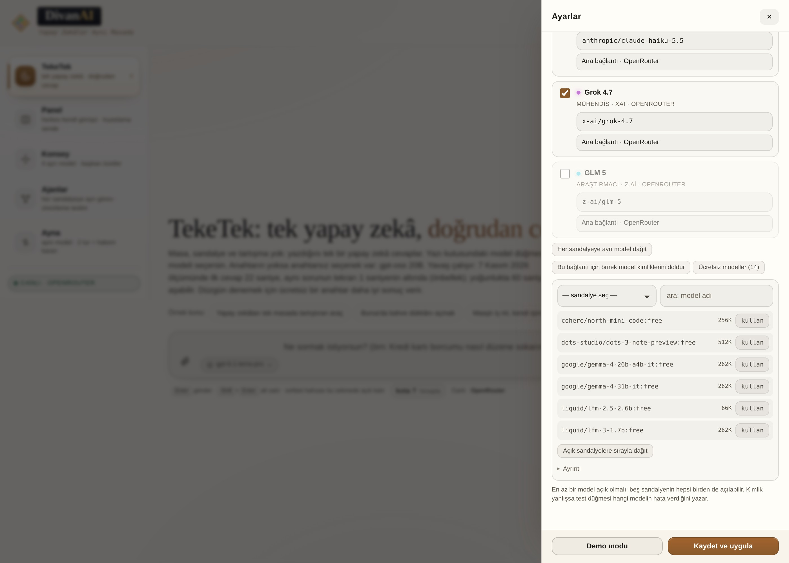

**One key, many vendors (Kol 135).** With OpenRouter each seat gets **its own vendor’s** model:
ChatGPT → `openai/…`, Gemini → `google/…`, Claude → `anthropic/…`, Grok → `x-ai/…`.
The model id and its vendor are shown on the card. If a seat’s brand and the running model differ
(e.g. a Google key only has Gemini), the card shows the **real model** and says so underneath
("ChatGPT seat · Google") — the name on screen is always the model that **actually runs**.

---

## Honest limits (summary)

Not marketing — measurements:

| Topic | Reality |
|---|---|
| **"Free"** | The app charges nothing, wants no account, counts no requests. **The services** set limits: OpenRouter `:free` models 50 requests a day (a round costs 4 → ~12 rounds), Groq free tier 1,000 a day, Pollinations publishes no quota but throttles under load. |
| **Demo mode (keyless)** | Real answers, not canned text — but it **cannot read images** and it is slow (first answer 20–60 s). **Live** mode requires an API key. |

| **Web search** | OpenRouter only and **paid**: ~0.7–1.5 cents per request, even on a free model. Off by default. |
| **Mirror** | Same model in two roles: it makes self-approval harder. It does **not** catch a blind spot the model shares everywhere — no substitute for changing the model. |
| **Number rule** | Turns unsourced amounts into `[?]`; it does not make the answer correct. Ratios can be wrong too, but they are debatable. |
| **Key lock** | Off by default, keys are plain text. Enabling it is optional; a forgotten passphrase cannot be recovered. |

---

## Quick start (30 seconds)

1. Download the `divanai` folder and double-click **`index.html`**. (No Python, no install, no internet needed.)
2. Pick the table type at the top: **Council · Panel · Mirror · Agents · OneOnOne**.

**Start with no setup at all.** The app opens in **Demo** mode and sets up **three keyless seats**:
**OVH AI Endpoints** (Llama 3.3 70B), **LLM7.io** (Codestral), **Pollinations** (gpt-oss 20B) — three
separate services, **no signup, no key, no card**. The answers are real; the first round is slow (measured
7 Nov 2026: a three-seat round took **~65 seconds**; LLM7 takes one request at a time, OVH two a minute).
3. Type the topic into the box and press `Enter`. *(Example: "Is opening a small coffee shop in Bursa sensible?")
4. In Demo mode **no key is spent**; the free services use their own daily quota. When one runs out the
   seat leaves a one-line note and moves to the next free service.

**Faster is optional (3 steps):** ① create an account with a free provider — the most generous free tier
is **Google AI Studio** (no credit card, and the daily allowance is counted **per model**); ② copy the
key, ③ Settings → **Free · your own key** → **Google AI Studio** → paste the key → **⇅ Test connection** →
**Save and apply**. Clicking a connection card applies that service to **every seat**; the app tells you so
with a notice. Paid services (**Vercel, Requesty, NanoGPT, AIMLAPI**…) are not in the main list — they sit
folded under **Other services**, so leave them closed unless you need them. Every card carries a
**no card / card required** tag.
The key is kept **in this browser only** (`localStorage`); it never goes to a server, a file or a store.
To try something free, put an id ending in `:free` — e.g. `google/gemma-4-31b-it:free`.

**A different model on every seat in Live.** Switching to Live opens **4 seats** and spreads them over
**different models** — they do not all speak with the same one. The spread comes from two sources:
① when you save the key the app fetches the service's **own model list** (`/models`) and gives each seat a
separate id, favouring a mix of vendors; ② if the list cannot be fetched, the connection's **vetted presets**
are spread in turn. When the pool is smaller than the table (Google's vetted presets hold 2 models:
3.5 Flash-Lite + 3.1 Flash-Lite) they repeat in turn and the drawer **says so**. You can **change any seat's
model by hand** in the list below; an id you type is kept at startup and never overwritten by the automatic
spread. To re-spread, press **Spread a different model per seat**.

*Settings opens like this: mode at the top, then the **three keyless services** (Pollinations · LLM7.io ·
OVH), then free services that need a key; paid ones stay folded under **Other services**.*

**On a phone:** the same file works; the layout holds down to 360 px.

---

## Using it

### 0 · Left panel (table types)

The table type now lives in a **vertical list on the left**: **OneOnOne · Panel · Council · Agents · Mirror**
(the first visit is **OneOnOne** — the familiar single chat). Under the panel sits the **Demo / Live**
label.

**The panel's language (desktop):** each mode is a **row**, not a card box — a rounded square holding the
icon, the name and a one-line description beside it. The selected row sits on **cream**, gains a
**brass bar** on its left and a `›` arrow on its right; hovering slides the row **2 px to the right**.
The panel is **264 px** wide: a shade lighter than the paper in day mode, slate in night mode. On the phone the panel is a **horizontal strip** across the top; the Demo/Live label stays
right below it.

The top bar now has **no text**: on the right just a **dot** (green = Demo). Tapping it opens Settings.
The **Settings** button is icon-only (a gear); its accessible name stays for screen readers.

**No left panel on the phone:** table types sit on the home screen as **two-column cards**
(the old layout), with the Demo/Live label right below. The left panel is desktop-only (901 px+).

**Settings got simpler:** four categories — **Connection · Table · Flow · Advanced**. Long
explanations fold under “Details”; rarely used sections start collapsed. No setting was removed,
only less text is shown.

### 1 · Set the table

| What | Where | Note |
|---|---|---|
| **Table type** | The four buttons at the top | Switching clears the current conversation (it warns first) |
| **Topic** | The input box at the bottom | `Enter` starts, `Shift+Enter` new line |
| **Attach a file** | The **paperclip** left of the text box | Image · PDF · Word (.docx) · Excel (.xlsx) · PowerPoint (.pptx) · text/code. You can also paste with **Ctrl+V** or drag and drop. In **every mode** the file goes to the seats with that question |
| **Agenda** | The chips under the topic | **Generate ideas · Debate & critique · Decide** — Council only; Mirror's agenda is fixed |
| **Language** | The two flags in the top bar (Turkish · English) | Translates the whole interface TR ⇄ EN; the choice is remembered. Answers and your topic are never translated |
| **Model** | The picker next to the list in Mirror and OneOnOne | In OneOnOne: **Pollinations · keyless** or **your own connection** |
| **History** | The clock icon in the top bar | Last 10 conversations in this browser + **favorites** · open, continue, delete |
| **Don't show again** | Top right of the key card | Hides the “3 steps to live models” card for good (turns off the key prompt on the main screen) |

**While the conversation runs:**
- You can drop a **note** at the bottom — the next speakers see it.
- **Stop** cuts the table instantly; answers already written are kept.

### 1b · History and moving between devices

No account, no login. So that conversations are not lost, there are three things:

| What | Where | What it does |
|---|---|---|
| **Last session** | Automatic | Reload the page or reopen the tab and the conversation is still there |
| **History list** | Top bar → **clock icon** | The last **10 conversations** in this browser: date, mode, message count. Click one → continue where you stopped. `×` deletes one by one, the button at the bottom clears all |
| **Favorites** | The **star** (☆) on a row | Mark an important conversation: it stays **at the top** in its own section and the limit of 10 **does not delete it** (up to 30 favorites) |
| **Session file** | Same panel → **Save session to file / Open from file** | A `.json` file to move to another device. Send it to yourself over WhatsApp/Drive/email and open it there |

The history list lives **only in that browser's store**; it never goes to a server and needs no account.
If you clear browser data the list goes too — so **save** important conversations to a file or use
**Export**. Images themselves are not stored (to save space); an old conversation opened from the list
shows the image box as “lost”.

### 2 · When a round ends

| Button | What it does |
|---|---|
| **+ One more round** | Deepens the same topic; the chair's closing is renewed |
| **Summarize** | The chair's decision in one card: Result · pros/cons · first step |
| **Export** | **Word (.docx)** · **Text (.txt)** · **Markdown (.md)** — the file is built in the browser |
| **Copy** | The whole table to the clipboard as markdown |
| **New table** | Clears the conversation and the pause record |

The table is **saved automatically**: reload and the last session comes back. Conversation history is
not part of the settings backup; take it with **Export**.

### 3 · Settings (what you actually need)

**Models at the table**
- Turn each seat on or off (at least one must stay on). DivanAI knows five providers:
  ChatGPT, Gemini, Claude, Grok, DeepSeek — **all five** can be on at once.
- **Paste the key and models appear by themselves**: the chosen service's own model list is fetched and
  models from that service land on the five seats. No need to type model ids by hand. A model you picked
  yourself, if the service has it, is **kept**, not overwritten.
- **Chair**: the seat that writes the summary and the closing.
- **Model picking lives on the chat screen**: in **Solo** and **Mirror** modes the model is written on
  a **small button inside the text box** (next to the paperclip) — no long list above it. Pressing the
  button opens a **searchable window**: type to filter, models are grouped, and the current one carries
  a ✓. Options: the keyless free services (OVH · LLM7 · Pollinations), the connection's own model list,
  or its presets. **Each model appears once** — when a service and a preset point at the same model,
  only one row remains. The choice is stored in the browser and survives a reload.
  (The old *Mirror model* picker under Settings → Table and the second model list in the left rail were
  removed.)
- **Chair and roles live together**: Settings → Table → **Roles**. The list at the top picks the
  **chair** (it writes the summary and the close); the chair's row carries a **CHAIR** badge and, in
  Solo mode, the speaking seat carries a **SPEAKING** badge.
- **Roles**: you set each seat's **role label** and **one-line job** in the same place.
  The fields are white boxes — click and type; the badge beside them updates **as you type**.
  The role applies in **every mode, including Solo**: the label shows in the bubble and the job shapes
  the model's voice. In Solo only one seat speaks, so only **its** role applies; that seat is marked
  **SPEAKING** in the drawer.
- The **Free models** button lists the free models the provider publishes; pick **which seat** first, then
  press **use** on the row. No seat changes until you choose. **+ New seat** adds a provider that is not
  at the table yet. The button appears **only for the four providers that expose their list to the browser**:
  OpenRouter, LLM7, Pollinations, OVH. Elsewhere (Groq, Google, DeepSeek, Mistral, Together, Cerebras,
  Vercel, Requesty, NanoGPT, AI/ML API, xAI, OpenAI) the model list cannot be fetched without a key or
  from a browser, so the button is **not shown** — copy a model id from the provider's site instead. The list shows **chat-capable models only**: non-chat rows in the provider's list
  (text-to-speech **TTS** models, speech recognition, image generation, embeddings/reranking, music)
  are filtered out — they cannot answer at the table.

**Conversation settings**

| Setting | What it does | Default |
|---|---|---|
| **Tone** | Natural chat (short sentences, no filler) · Report layout (Result/Pros/Cons/First step) · Brief points | **Natural chat** |
| **Answer limit** | Max words per speaker (30–500) | 130 |
| **Context** | Table memory (fewest tokens) · Compressed · Full history | **Table memory** |
| **Max rounds** | Round cap (2–20); when full the table stops and summarizes | 6 |
| **Stop when saturated** | Stops by itself if the last two rounds bring nothing new | On |
| **Web search** | Works on OpenRouter only and **spends credits**; leaving it off is free | Off |

**Connection**
Under **Free · your own key (no card needed)** in Settings → Connection four cards sit side by side:
**Google AI Studio · Groq · Z.ai · OpenRouter**. None of them asks for a credit card; tap one and every
seat at the table moves to that service.
To stay free, start with **Google AI Studio**: no credit card, the Flash and Flash-Lite models are free,
and the daily allowance is counted **per model** — so four seats on four different Gemini models use four
separate allowances. (The exact daily numbers live in AI Studio → *Rate limits*; Google can change them
per country.) It reads images, so you can attach a photo. **Z.ai (GLM)** is card-free too: GLM-4.7-Flash and GLM-4.5-Flash are listed as *free* with no
published request quota (a per-minute limit may apply). Two **keyless** options also exist: **LLM7.io**
(1 request at a time) and **OVH AI Endpoints** (2 requests a minute) — single-seat only, but no signup.
**OpenRouter** gives many models behind one key
(free `:free` models, **50 requests a day**); **Groq** is the fast one (**1,000 a day**, but 8k tokens a
minute). If you want a single provider you can connect directly with its own key — **Groq, DeepSeek,
Mistral, xAI, OpenAI**. **Cerebras** no longer offers a permanent free tier (a 30-day $5 trial credit,
with a verified payment method). Groq's free models changed as well: **llama-3.1/3.3 were removed on
16 August 2026**, so the preset now uses `openai/gpt-oss-120b`, `openai/gpt-oss-20b` and `qwen/qwen3.8-27b`. Your own OpenAI-compatible address (LiteLLM, Cloudflare AI Gateway) goes on the **Custom
address** card. The key never reaches any server: it stays in your browser.

**⇅ Test connection** sends a one-word request to every open seat and reports line by line:
`✕ Claude · 401 invalid api key` (wrong key), `✕ Grok · 404 model not found` (wrong model id),
`429` (quota), CORS (browser blocked). On a connection problem, **run this first.**

> If you get **403 "Key limit exceeded"**, the key is valid but its **spend limit** is zero.
> Go to `openrouter.ai/settings/keys` → the key → raise **Limit** (adding credit alone is not enough).

**Per-seat connection.** Each seat can use its own provider; the daily free allowance stacks. Example:
ChatGPT → **Google AI Studio** (Gemini 3.8 Flash), Gemini → **Google AI Studio** (Gemini 3.5 Flash-Lite),
Claude → **Google AI Studio** (Gemini 3.6 Flash), Grok → **Groq** (1,000/day). All four are card-free;
three of them are Gemini models, so they draw on three separate model allowances. A seat with its own connection that hits 429 rests **alone**; on a shared connection
all seats rest together (see *Not wasting tokens* below). Settings → *Models at the table* → the list
under the row. A seat with its own connection shows a badge such as `⛁ Groq` on the table screen.

**Daily quota.** The bottom bar shows `7 / 50` and `resets in 23h 24m` (green: plenty, yellow: low,
red: out). Click the label → the quota box opens. OpenRouter free allowance is **50 a day**, reset at
**03:00**; Groq **1,000/day**; Gemini depends on the model, **10:00**. The counter spends no requests.
For services whose reset time is unknown the app does **not invent a clock** — it says “at the provider's
own daily reset”.

**When the quota runs out.** Two cases:

- **Every seat on its own service** (the default setup: Pollinations · LLM7 · OVH): only the seat whose quota
  ran out stops, with a one-line notice (`Mistral Nemo is done for today…`). **The table carries on** —
  the other seats keep talking on their own services.
- **Seats sharing one key** (a single Google/OpenRouter key): they all draw from the same pool, so the
  table stays where it is and a green button appears:
**▶ Continue where you left off · 3 speakers**. Press it once the allowance resets; **only the missing**
seats run, nothing is regenerated from scratch. Close the site and the state is remembered. With quota
at 0 the Summarize button sends no request at all and builds a **local summary** from the sentences on
the table (card title: “Local summary · no model called”).

**Backup.** Settings live **in this browser**. Move them with *Download backup (.json)* / *Load from
backup*. Keys are **not written** to the file by default; tick the box and it carries them as plain
text (a red warning appears). If the backup has no keys, the keys in this browser are kept; a broken
file changes nothing.

**Table memory (default).** Every seat does not re-read the whole history before speaking. The app
shrinks old rounds into one-line notes; the model receives only **your first question + that note + the
last two messages**. The note is **invisible** on screen — it only cuts token spending. On the same
table spending drops roughly six-fold: 10–15 tables a day instead of 2–3.

**Three rules against wasting tokens.** (The *Token saving* section in Settings was removed in Kol 127;
the rules always run.)

- **Passing (on, Council).** From round 2 on, a seat with nothing new to say writes no answer and just
  says `PASS`. There is no passing in round 1 or for the closing speaker (the chair); Mirror and Agents
  have none at all. One line appears on the table: *"Gemini saw no new point · passed, no answer written."*
- **Seat timeout (120 s).** If a seat cannot finish in time **only that seat** is cut, the table does not
  hang. Text longer than 30 characters is **kept** and placed on the table marked “cut short”.
- **Keyless seats cap at 60 s.** Free services slow down under load; and on services that queue (OVH, two
  requests a minute) **time spent in the queue does not count** towards the timeout (at most 45 s is added).
  A request that is actually working is therefore not cut just because it was waiting in line.
- **The backup-model note is one line.** The line “could not answer · trying a backup model…” is updated
  when the job finishes (“Codestral took over” or “could not speak this round”); no second, contradictory
  sentence is added underneath.
- **Reasoning text only.** Some models (OVH's Qwen 3.8, for example) produce only reasoning text instead of
  a visible answer. The app does **not** call that “gave no answer”: it says “produced no visible answer ·
  only reasoning text arrived” and names which model on that service does answer directly.
- **If the chair cannot write the summary** the table is not left empty-handed: the card is produced as a
  **local summary** from the last sentences (“The summary could not be written by a model: the chair seat
  did not answer”) and one line explains what happened. The card is credited to **“Local summary · local
  only”**, not to the chair — no one signs text they did not write.

- **Provider cooldown (1 min).** A **connection** that returns 429 or “out of credits” is not tried at
  all for this period; the seat shows `resting · 16:19`. If all are resting the table pauses and resumes
  with **▶ Continue where you left off** when the time is up. **End cooldown** reopens without waiting.

On a shared key (OpenRouter, say) a 429 is **account-wide**: if one seat hits the wall, every seat on the
same connection rests. Give each seat its own connection and each spends its own allowance.

**Where does it apply?** Timeout and cooldown work in **all three table types** (in Agents the chain does
not hang either; the step of a resting connection is skipped). Passing exists only in **Council**. The
daily quota does not create a cooldown — waiting 5 minutes does not fix it; that is what the pause and
**Continue where you left off** are for. The continue button is an explicit intervention: it also lifts
any cooldown wait.

---

## Attaching files and images

Use the **paperclip** left of the text box (or **Ctrl+V** / drag and drop) to attach a file to your question.
A small **tray** appears above the box with the file name, size, page count and a ✕ button. Press `Enter` and
the file goes to **every seat at the table** with that question; they all read the same document.

| File | What happens |
|---|---|
| **Image** (png · jpg · webp …) | Long edge is reduced to 896 px and sent **as an image**. Only vision-capable models can comment on it (most of the GPT, Gemini, Claude and Grok families via OpenRouter). **The keyless option cannot read images** (measured: it returns 400); the app then skips the image, shows a one-line warning and continues with the document text. |
| **PDF** | The **selectable text** is extracted (in your browser, no add-ons). If a scanned PDF has no text, the app says so: upload a screenshot of the page instead. |
| **Word (.docx)** | Paragraphs and tables become text. |
| **Excel (.xlsx)** | Sheet by sheet, cells become **tab-separated** text. |
| **PowerPoint (.pptx)** | Text is pulled slide by slide. |
| **Text / code** (.txt · .md · .csv · .json · .html · .js · .py …) | Added as is; HTML tags are stripped. |

If a connection has no vision (or the model rejects images) the app notices: it strips the images, retries
**once**, shows a one-line warning and never sends images to that connection again. Document text always goes
through.

Limits: one file **25 MB**, **6 files** per message, **24k characters** per document (the beginning is kept
and the app tells you). Files are read **in your browser** and never uploaded anywhere — they only travel to
the model provider you picked, inside the request body. An image is not resent every round: it rides along
in the message it arrived in and in the **next** one, then it is only referenced as text.

## Panel

Seats answer **at the same time** and **do not see each other**: each seat only sees your questions and
**its own** earlier answers. No chair, no summary, no judge — the views are written one under the other and
**the comparison is yours**. Pick this when you want to see what four models say about the same question,
side by side and without influence. Each message costs one request per seat (4 seats = 4 requests) and the
four answers arrive together; you do not wait in turn.

## Council

3–5 separate models at one table; each has a role and the chair has the last word.

| Seat | Role | What it does |
|---|---|---|
| ChatGPT | **Moderator** | Opens the table, runs the debate |
| Gemini | **Analyst** | Splits the topic into layers, sets criteria and assumptions |
| Claude | **Critic** | Flags weak points, risks, hidden costs |
| Grok | **Engineer** | Feasibility, steps, timing |
| DeepSeek | **Researcher** | Data, examples, comparisons (off by default) |
| One of them | **Chair** | Has the last word, writes the summary |

Roles are not sticky: turn models on and off, change the chair, rewrite the roles. The heading follows
the setting too — with 5 seats open it reads “Five AI minds, one table”.

**Three rules for every speaker** (baked into the system prompt): **short** (no decoration, no intro
lines), **objective** (no invented numbers or prices; with no data it says “no evidence”), **no
repetition** (no restating what was already said, no “X said that”). With nothing new it says so plainly.

---

## OneOnOne

A single AI at the table; no debate, no turns, no chair. It answers what you write and keeps the chat's
memory as you continue. Two options:

| Option | What it needs | When |
|---|---|---|
| **Pollinations · keyless** | Nothing — no signup, no key | First try, single question, free use |
| **My own connection** | A provider + key in Settings → Connection | You already have a key, you want no limits |

**The keyless option has a limit:** Pollinations publishes no quota; under load it throttles requests
(7 November 2026 measurement: first answer 22 seconds, under a second when cached; under load it may pass 60 seconds). If the server returns a 402 the app says how many
seconds to wait and retries once by itself — you never see an empty error screen. The server runs best-effort and may slow down now and then. The model's **inner reasoning**
is not printed, only the answer. The chat is not saved anywhere; since no key is used there is nothing
to lose.

---

## Mirror

One model takes two seats: **A defends, B objects**. In the first round A opens; in the second round
**B opens and A objects** — so neither side is stuck defending. At the end the same model writes a
verdict as a **neutral judge**: which side is right where, the strongest 2+2 arguments of defence and
objection, the point that cannot be decided and the data that would settle it, and the first step.

- **+ One more round**: a new round is played, the verdict is renewed (the old verdict card is removed).
- Mirror has **no agenda picker** — it is always *debate & critique*.
- Cost: **2 rounds + verdict = 5 requests** (single model).

---

## Agents

Council and Mirror **debate** a question; Agents **do** a project.

1. Write the **project** (one sentence): *"Draw up a 6-week launch plan for a small handmade soap brand."*
2. Give each seat a **Task** and an **Expected output**. The second is the acceptance criterion. An agent
   left empty is skipped.
3. Pick the **flow** (table below).
4. Send. Agents work in turn and every step shows on screen (**1 ✓ 2 ● 3 · 4 ·**).
5. At the end a **TEAM DELIVERY** card appears: summary, who did what, the real output, what is still
   open, first step.
6. Not enough? **+ One more pass**: the agents now try to close what the previous pass left open.

| Flow | What it does | Requests |
|---|---|---|
| **Sequential** (default) | 1 → 2 → 3 → 4; each agent gets the previous one's hand-off package | 4 agents + merge = **5** |
| **Supervisor** | The chair splits the work first, agents follow the plan, the chair merges | **6** |
| **Relay** | Each agent picks the next one; stops on "DONE" | cap **8** |

**How many agents (2…5).** The **Agent count** picker at the top right of the setup: `2` · `3` ·
`4 (all)`. It only **narrows** — the first N open seats run, the roster is not deleted; the **≈ N
requests** estimate above drops. The **＋ Add DeepSeek** button opens the fifth seat in one click.

**Pause at every step.** Ticked, you press **Continue** after each agent, so you can cut a chain that is
going wrong. **Passes: 1 / 2 / 3** runs the same roster several times.

**Ready roster.** The **Roster** button at the top right of each seat card: **12 Turkish templates** +
**268 English expert entries**. Search works in both languages (`finans` finds *Financial analyst* and
*finance*). A pick is written **only to that seat**: role + task + expected output. On a filled seat it
asks first.

**Hand-off package.** Each agent appends a structured package to its answer (GOAL · SETTLED · OPEN ·
EVIDENCE · CONSTRAINT · LIMIT · NEXT). The next agent sees **only this package**, not the whole
conversation: cost does not grow quadratically along the chain and constraints do not get lost.

**Reset.** **✦ Clear** in the setup clears tasks, the project sentence and the conversation.

**In Demo mode** the answers are real too (three free services); only no key is spent, and speed and quota
depend on each service's own limit.

**Three seats in Demo = three separate services, three separate models.** On first open the table is set as
**Pollinations → gpt-oss 20B** (chair), **LLM7 → Codestral**, **OVH → Llama 3.3 70B**. What a seat, an agent
card or Mirror shows is the **model and service the request actually goes to** — never a brand name like
"ChatGPT" or "Grok". (Before Kol 133 the chair seat was pulled to Pollinations, so two seats landed on the
same model and OVH was never used.)

---

## Images (Agents)

In the setup, tick **"Draw an image from this agent's text"** under a seat card; that agent draws an
image after finishing its text. In the ready projects it is pre-ticked for **Magazine issue** (cover),
**Restaurant opening** (storefront) and **Product launch** (campaign image).

> **The agent does not draw the image itself.** ChatGPT/Gemini/Claude/Grok produce text; the image is
> drawn by the selected **image engine**. The agent only writes the prompt (the `IMAGE PROMPT:` line in
> its answer; if absent, *GOAL* in the hand-off package; if that is absent too, the first 260 characters).

| Engine | Key | Cost | Limit | Note |
|---|---|---|---|---|
| **Free** (default) | Not needed | **0** | **1 image per 45 s** per IP | Small `pollinations.ai` watermark bottom right; weak at text/letters, long edge 1024 px |
| **OpenRouter** | Your own key | ~**$0.001–0.003** per image | The provider's limit | No watermark, high quality; **asks once per session** |

**Ratio.** Six buttons on the IMAGE row: `1:1` square · `4:3` card · `3:2` photo · `16:9` wide · `9:16`
vertical · `21:9` cinema. The choice is remembered and shows as a label on the card. The size written on
the card is the size actually requested (the free engine keeps the long edge at 1024 and DivanAI
downloads accordingly).

**Camera tags.** `Morning light · Portrait · Wide angle · Product shot · Cinematic · Flat drawing` —
they **append text to the image prompt**; no credits, no model change. Press again to turn off; a part
already present in the prompt is not repeated.

**Behaviour**
- An image is a **separate request**; it does not count as agent chat. It reads “≈ 5 requests · 1 image (free)”.
- In live mode, before starting you are **asked** how many images will be drawn and which engine is used;
  decline and the text part still completes.
- **No ready-made images in Demo mode** (no key). To try one by one, use the **Generate image** button at
  the top of an answer; the image engine needs a key.
- At the rate limit the card counts down “Image queued · N s”. If the server answers busy (503), DivanAI
  retries **once** after 6 seconds.
- **Images are not stored** (so they do not fill browser quota). Reload the page and the picture is gone;
  **Regenerate** brings it back. Export writes the **prompt**, not the image.

---

## Language

**The interface is bilingual: Turkish and English.** Press one of the two flags in the top bar and all
text switches — buttons, help, settings, warnings, confirmation boxes, export headings. The choice is
stored in the browser and survives a reload. On first open, if the browser language is not Turkish, the
interface starts in English.

Answers come **in the language you write**: Turkish if you write Turkish, English if you write English.
The app detects the topic's language and adds it to every model's instruction.

**What is not translated:** your topic, the chat bubbles and the model answers. They belong to you and
stay exactly as written whatever the interface language. Demo and Live follow the same rule: a model answer
comes in the language you wrote the topic in.

---

## Number rule — the models do not invent prices

The models never write absolute amounts for price, cost, revenue, rent or salary. This is enforced in code:

| Layer | What happens |
|---|---|
| **Prompt** | "Write no TRY / $ / € amounts; write ratios, thresholds and formulas; leave `[rent]` as a slot instead" |
| **Check** | Every answer is scanned for a number plus a unit (`5,000 TRY`, `26 cups`, `45 m²`). Your own numbers and any sources are **exempt** |
| **Repair** | Unsourced amounts become `[?]` and a note is added under the bubble: *"2 unsourced amounts hidden → [?]"*. **No second model call** |

**Allowed:** ratios, formulas, durations, years, the app's own facts, numbers you typed.
**Banned:** invented amounts and invented ratios.

Settings ▸ **Table setup** ▸ *Number rule* — on by default.

---

## Search in history · key lock

**Search.** The clock icon in the top bar opens the history list; typing in the box filters it live —
it searches the topic, table type, date and the conversation text. `Esc` clears the query.

**Key lock (optional).** Keys normally sit in this browser's local storage as **plain text** — anyone
reading the browser data can see them. Set a **passphrase** in Settings → Connection and the keys are
encrypted with **PBKDF2 (150,000 rounds) + AES-GCM-256**; only the encrypted box stays in storage.
The lock closes on every reload; you open it with your passphrase. **If you forget it the keys cannot
be recovered** — keep a copy elsewhere. Removing the lock is one button.

---

## Appearance · day and night

Two themes; layout never changes — only colours and heading typeface.

| | **Day (default)** | **Night** |
|---|---|---|
| Background | paper `#f6f2ea` | night `#08090d` |
| Ink | `#1b1a17` | `#eef1f7` |
| Accent | amber `#8a5a2b` | gold `#f5c76a` |
| Headings | serif (Georgia) | sans-serif |

Toggle with the **single icon** in the top bar: a moon in day mode, a sun in night mode (the icon
shows where you are going). The choice is stored in the browser; the first visit is **day**.
The `G` key toggles too (not while typing). The settings drawer also has a `☀ Day / ☾ Night` row.

The brand is now a **strip**: no round plaque, no double frame, no brass line on top. The dark
surface sits **only behind the name** — a thin, sharp-cornered strip; the **tagline sits outside the
strip**, on the paper. The **AI** in the name is brass. On a paper-coloured page the brand is the only
dark object, so the eye lands on it first. **Clicking it takes you home**; if the table has a
conversation it asks first, and while a round is running it does nothing (press “Stop”). It works by
keyboard too — the brand is a button: `Tab` to focus, `Enter` to press.

The **icon** sits on the left, **34 px** (32 px on phones): a brass **diamond** holding the four seats
at the table (green · blue · orange · purple). The brand name is **24 px** serif (22 px on phones).
The tab icon and the phone icon use the same diamond and the same colours.

**Motion:** hovering the brand **sweeps a brass line from left to right** under the tagline and lifts
the icon a hair; moving away closes the line again. With `prefers-reduced-motion` only the colour
changes — nothing slides.

**The Demo table (three rows, three separate models):**

| Seat | Service | Model | Role |
|---|---|---|---|
| 1 | Pollinations | gpt-oss 20B | Moderator · chair |
| 2 | LLM7.io | Codestral | Analyst |
| 3 | OVH AI Endpoints | Llama 3.3 70B | Critic |

**Task cards and image settings (Kol 134).** The task cards, the image/camera strip and the flow bar
on the Agents screen were painted black for the night theme; in the daytime "notebook" theme they
looked muddy grey on hover and read as *disabled*. These surfaces now follow the theme: paper white
by day, dark as before at night. A browser test checks that text can be typed and the buttons are
really clickable.

**Left panel:** how it sits in day mode, the hover slide, and the night look.

**On the phone the top bar is two rows, both centred:**

| Row | Content |
|---|---|
| 1 | Logo plaque (name + slogan) — **exactly centred** |
| 2 | theme · language · help · history · **support** · **Settings** — group centred |

The brand name is never truncated at any width (it used to shrink to “Div…”); under 360 px only the
centred Demo/Live badge is hidden.

Contrast clears WCAG AA: body 15.6 · secondary 8.4 · dim 6.0 · button label 5.8.
With `prefers-reduced-motion`, the transition is disabled.

---

## Share · link and conversation summary

When the conversation ends, **Export · Share · Copy** appear above the text box.
**Share** does two things: it shares the page **address**, and if you want it adds a
**summary of the conversation**.

| Where | When it shows |
|---|---|
| Bottom bar, between Export and Copy | When the table has a conversation (same rule as Export and Copy) |

| What is shared | Where | What goes along |
|---|---|---|
| **Link** | WhatsApp · Telegram · X · Facebook · LinkedIn · E-mail | Only the address plus **one line of title** (“DivanAI — AIs at the same table”). The preview card shows the title, description and image (og tags) |
| **Conversation summary** | Copy · WhatsApp · E-mail · the device share sheet | Topic (first 200 characters), each seat's answer (first 220), the chair summary if any (first 320) and the address — **at most 1,500 characters** |

The summary is built **on your device**; it never goes to a server. The whole conversation is
not packed into the URL: a long chat would become a link tens of thousands of characters long
and most apps would cut it. For the full text use **Export** (Word · text · Markdown).

When you open the page locally (`localhost`) the share button gives the `canonical` address
instead of your own machine's — `localhost` does not open on anyone else's computer.

---

## Install on your phone (like an app)

The site is a **PWA**. On Chrome/Edge use the **Install** button in the address bar; on
iPhone/iPad use **Share → Add to Home Screen**. Once installed it opens full screen and, after
the first visit, **opens without internet too**: the service worker caches the latest version
and always fetches a fresh one when you are online (no stale version stuck).

- Installation works **only from the site address** (https). If you double-click `index.html`
  the browser offers no install; the app still works normally.
- The package carries **4 small companion files**: `manifest.json`, `sw.js`, `icon-192.png`,
  `icon-512.png`. The app itself is still a single file (`index.html`); without those four it
  opens fine, only installation and offline start do not work.
- The “Share on device” button appears only in browsers that support it.

---

## Where is the data?

Short answer: **with you.** DivanAI has no server, no account, no database of its own.

| What | Where it lives | Who can see it |
|---|---|---|
| Your API key | Only in **your browser's** `localStorage` | You. Never sent to any server; even GitHub, which hosts the page, cannot see it |
| Your settings (models, roles, tone, round count) | Same place, your browser | You |
| The last conversation | In the browser session; reload and it comes back | You |
| The topic and text you write | Goes **to the provider you chose** (OpenRouter, Groq, OpenAI…) as a request | That provider, under its own privacy policy |
| The `.md` file you save | On your own computer, wherever you downloaded it | You |
| Cookies, tracking, ads | **None** | — |

> The key lives in your browser: on a shared computer use **Demo** mode when opening DivanAI (the key is never
> used there), or lock the keys with a passphrase. If you did
> enter a key, Settings → empty the key field → **Save**; the key is removed from the browser.

**If you want to delete it:** empty the key field in Settings and save (the key is gone), or clear the
site data of this page in your browser (settings go too). There is nothing to delete on a server, because
nothing is held on a server.

**Tasks in Agents mode** are kept only for the open session; closing the page ends them. If you want,
take a backup from the menu: the backup file lands on your computer and belongs to you.

---

## When something is stuck

| Symptom | What to do |
|---|---|
| "… is done for today (free daily quota is used up)" | **Only that seat** stops; the other seats carry on with their own services. If several seats share one key, the table waits and **▶ Continue where you left off** appears |
| `401 invalid api key` | Wrong key: paste it again in Settings, **⇅ Test connection** |
| `404 model not found` | Wrong model id: fix the id on the row (it differs per service) |
| `403 Key limit exceeded` | The key's **spend limit** is zero: `openrouter.ai/settings/keys` → raise Limit |
| A seat went silent | DivanAI switches to a backup and writes `↺ model` in the answer header; the round does not stop |
| Answer cut short | It retries once by itself; if it continues, lower the word limit in Settings or pick a smaller model |
| No image | Rate limit (45 s) or server busy (503); press **Retry** on the card |
| Empty/repeating answer | Free models get crowded; try another free model or move to a paid one |
| The table takes too long | **Stop**, lower **Max rounds**, keep **Stop when saturated** on |
| Settings disappeared | Browser data was cleared: **Load from backup** (keys are entered separately) |

---

## Free services · measured 6 November 2026

The default setup runs on **three keyless services**. Instead of guessing which one does what,
I measured them: same question, single request, streaming on, 6 November 2026.

| Service | Model | Time | Result |
|---|---|---|---|
| OVH AI Endpoints | Llama 3.3 70B | 0.7 s | clean answer |
| OVH AI Endpoints | Mistral Small 3.2 | 2.4 s | clean answer |
| LLM7.io | Codestral | 0.8–1.0 s | clean answer — **429 once the daily quota is used up** (server: "retry in 24 h") |
| Pollinations | gpt-oss 20B | 6 s – 45 s | a reasoning model; under load no visible text arrives at all |
| OVH AI Endpoints | Qwen 3.8 27B | 51 s | **empty** — reasoning text only, removed from the presets |
| LLM7.io | Mistral Nemo | 5.7 s | **broken Turkish** (foreign words mid-sentence), removed |

What changed on 6 November because of this:

- **Broken models are gone.** Mistral Nemo (LLM7) and Qwen 3.8 (OVH) are no longer in the presets.
  If your saved settings still point at them, they are switched to Codestral / Llama 3.3
  **automatically** on open — nothing to do by hand.
- **Order follows speed.** The first seat and the chair now run on **OVH Llama 3.3** (0.7 s);
  LLM7 second, Pollinations third (slowest, rescue only).
- **The reasoning trap is cut.** If a model spends 12 seconds emitting only "thinking" text
  without visible output, that attempt is abandoned and the next free service takes over.
  It used to sit idle for 60 seconds (that was the "no answer within 60 s" line).
- **The fallback chain now changes service.** When a service returns 400/429/an empty answer,
  the seat tries another model on the same service and then the **next keyless service**
  (LLM7 → OVH → Pollinations). Before, it stayed inside one service and came back empty.
- **The note moved.** "Mistral Nemo could not answer · Codestral took over" now sits **above**
  the answer; it used to sit below and read like part of the answer.
- **A wrong model id repairs itself.** If a provider says "model not found" (404), the app asks
  that service's `/models` list, picks a working id, saves it and gets the answer. A preset that
  goes stale tomorrow will not lock the table.
- **Settings are honest.** The keyless view carries a 429/empty-answer warning and a
  **measured** note for each keyless service (speed, limit, which model actually works).

### If you want it smoother: a free key without a card

Keyless services run "best effort": they are free, so under load they make you wait. One
**card-free key** is enough for uninterrupted use. Options checked:

| Service | Card | Limit (source) | Note |
|---|---|---|---|
| **Google AI Studio** (Gemini) | no | The per-model limit is shown in **AI Studio → Rate limits**; community tracking puts the Flash class at ≈500 requests a day, 15–30 a minute (Oct 2026) | Free tier is open in Türkiye; reads images/PDF. The easiest and widest option here. |
| **Groq** | no | ≈1,000 requests a day, ≈30 a minute, 6–8k tokens a minute (community tracking) | Very fast; long answers hit the token cap. |
| **Cloudflare Workers AI** | no (account) | 10,000 neurons a day (Cloudflare announcement) | Smaller models; OpenAI-compatible endpoint. |
| **Z.ai (GLM)** | no | free GLM-4.7-Flash pool | Reported as quota-free; needs an account to verify. |
| **Mistral** | no (phone verification) | "Experiment" free tier | Limits are on the account page. |
| **Cohere** | no | trial: 1,000 requests a month | Trial allowance; not long-term. |

**Recommendation:** **Google AI Studio** first, then **Groq**. Neither needs a card; paste the key
in Settings → Connection and every seat moves to that service. None of this is required — the
keyless setup works too, it just makes you wait 20–60 seconds now and then.

## Known limits

- **Demo is a real model too; the price is speed and quota.** Three free services (OVH · LLM7 · Pollinations)
  answer keyless; there is no canned text. When a daily limit runs out that seat falls back.
- **Live mode requires an API key and the internet.** Without a key the live table will not run; Demo is there
  to try it.
- **Brevity is an upper bound.** A model will not exceed the limit but may write less than you need; for
  a long analysis open a new table focused on one topic.
- **At most 5 seats** — DivanAI knows five providers. Using the same provider in a second seat (e.g. two
  different GPT models) is not possible today.
- **Images vanish on reload**; the conversation text and prompts stay.
- **Backups do not sync between devices automatically** (no account/server, deliberately).
- **Installing to the phone works only from the site address** (https); if you double-click
  `index.html` no install button appears, but the app still opens normally.

---

## Screens

*DivanAI · one file · no external dependencies.*

---

## Licence

**Apache License 2.0** — full text in `LICENSE`, attribution in `NOTICE`.
The code is free; income comes only from voluntary donations. The 268 English expert entries in Agents
mode come from the [agency-agents](https://github.com/msitarzewski/agency-agents) project (MIT); see
`NOTICE` for details.

## Rename (MASA → DivanAI)

The app was never released as **MASA**; the name became **DivanAI** with version 1.25. For anyone who
tried an earlier version, old records in the browser **migrate by themselves**:

| Old record | New record | What it holds |
|---|---|---|
| `masa_settings_v1` | `divanai_settings_v1` | All settings, provider, **API keys** |
| `masa_session_v1` | `divanai_session_v1` | The unfinished conversation, pause record |
| `masa_req_v1` | `divanai_req_v1` | Today's request counter |
| `masa_quota_v1` | `divanai_quota_v1` | Pause when the quota ran out |

Opening the page once is enough: migration runs a single time and the old record is deleted.
**You do not have to do anything by hand**; your key and settings stay where they are. A `.json`
settings backup you downloaded earlier keeps working too (it is accepted even if the app name inside
says `MASA`).

---

## Security

### Short answer: no server, no account, no data collected

DivanAI is a single file. While it runs it **connects to no server** — neither ours nor anyone else's.
The conversation is created in your browser and stays on screen. Close the page and it ends.

The only exception is the model you choose: the topic you write goes **straight from your browser** to
the service you picked (OpenRouter, Groq, OpenAI…). Nobody sits in between and no copy is made.
Which means: **that service sees what you write.** If you are going to type secrets, ID numbers or
patient data, know that.

### Where does the key live?

In your browser's own local storage (localStorage), **on your computer only**. It is never sent anywhere; it only
goes to the address of the provider you chose, in the `Authorization` header.

That is not a vault — it is the browser's ordinary storage, kept so the key survives a reload. It is **not**
written into the exported settings backup and does not appear in a shared link. On a shared computer use
**Settings → Connection → “Delete from this browser”**, which removes the key from storage and from every seat.

Two situations to watch:

| Situation | What to do |
|---|---|
| A shared computer | Use **Demo** mode when opening DivanAI; do not enter a key. Or delete the key in Settings when you are done. |
| Browser sync (Chrome/Firefox account) | `localStorage` is not synced by default; if you still do not want the key in a profile tied to a browser account, use a separate profile. |

The key is **never** written to an exported file. When backing up settings the keys are deliberately left
out — even if you share the file, the key is not inside.

### What was checked before release

Before this version went out (34 automated security checks):

- **Running code from a model answer (XSS).** `<script>`, `onerror`, `onload`, `javascript:` links and
  `<iframe>` were hidden inside a model answer. All of them appeared **as text**; none ran.
- **A malicious settings backup.** A broken `.json` backup sent by someone else was used to inject code;
  it did not run.
- **Even when the same answer is kept in memory.** The conversation is stored in the browser; after
  reopening the page the malicious content still did not run.
- **Key leakage.** All network traffic was watched during a live round: the key went only to the chosen
  provider, never appeared in a URL, is not written on the page and is not in the exported file. A “trap
  server” was set up as well: **not a single request** went to it.
- **External resources.** The page has no external script, style, iframe, form or ad.

### Content security policy (CSP)

A **CSP** is set on the page. Because it is a single file, inline code is required; but **no code can be
loaded from outside**: remote scripts, iframes, objects, form submissions and `<base>` hijacking are
closed. So even if an escape hatch were found tomorrow, no outside code could be pulled in. The policy is
delivered with a `<meta>` tag inside the page, since GitHub Pages sends no custom headers.

In Kol 117 two more sources were opened, both **for our own site only** (`'self'`): `worker-src`
(the service worker file) and `manifest-src` (the app manifest). No worker or manifest can be
loaded from another domain; everything else stays `'none'`.

`Referrer-Policy: no-referrer` is set too: when you click an external link, your page address does not
leak to the other side.

### Local server (`server.py`)

Optional. It listens only on **127.0.0.1** (your own computer) and is unreachable from the network.
Directory listing is off, version info is hidden, broken URLs do not take the server down. You do not
need it for GitHub Pages.

### The one thing left on your side

- When writing the topic, know what is going to that service.
- Do not share your key; close the Settings window before taking a screenshot.
- Only take a suspicious `.json` settings backup from someone you trust.
