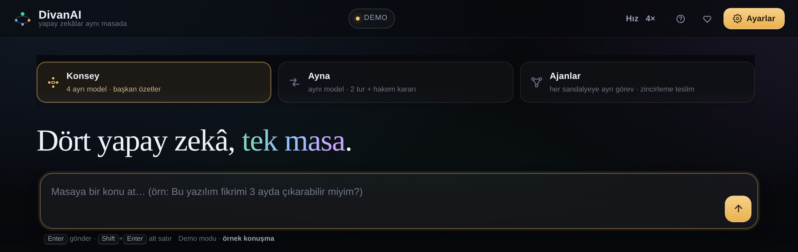

# DivanAI — yapay zekâlar aynı masada

**Site:** https://divanai.github.io/  ·  **Kaynak:** https://github.com/divanai/divanai.github.io

**Türkçe** · [English](README.en.md) — arayüz iki dilli: üst şeritteki bayraklarla Türkçe ⇄ İngilizce.

> **Divan**, Osmanlı'da devlet işlerinin görüşüldüğü meclis; **AI** eki onu yapay zekâya taşır.
> Okunuşu: *di-va-na-i*. Doğru yazım: **divanai** (bitişik, tamamı küçük harf).

Bir konu yazıyorsun; masadaki yapay zekâlar sırayla konuşuyor, birbirine itiraz ediyor, en sonunda
başkan toparlayıp özetliyor. Sekmeler arasında kopyala-yapıştır yok.

**Tek dosya.** `index.html`'e çift tıkla, açılır. Kurulum, hesap, sunucu gerekmez.
**Anahtarsız demo.** Hiçbir yere kayıt olmadan bütün akışı deneyebilirsin (demo metinleri canlı cevap
gibi sunulmaz).

| **Konsey** | **Panel** | **Ayna** | **Ajanlar** | **TekeTek** |
|---|---|---|---|---|
|  |  |  |  |  |
| 3–5 ayrı şirketin modeli, roller, başkan özeti | Sandalyeler **aynı anda**, birbirini görmeden yazar; **kıyaslama sende** | Aynı model iki sandalyede: savunan + itiraz eden, hakem kararı | Her sandalyeye ayrı görev, zincirleme teslim, tek teslimat | Tek yapay zekâ, doğrudan cevap; anahtarsız seçenek **yavaş** çalışır (45 sn'de 1 istek) |

Tek sohbet istersen **TekeTek**: masada tek yapay zekâ olur, yazdığını doğrudan cevaplar. **Anahtarsız
seçenek hazır gelir** (gpt-oss 20B, Pollinations) — kayıt olmadan gerçek cevap alırsın, ama
**IP başına 45 saniyede bir istek** verir; düzgün deneme için ücretsiz anahtar daha iyidir.

---

## Hemen başla (30 saniye)

1. `divanai` klasörünü indir, içindeki **`index.html`**'e çift tıkla. (Python, kurulum, internet gerekmez.)
2. Ekranın üstünden masa türünü seç: **Konsey · Panel · Ayna · Ajanlar · TekeTek**.

**Hiç anahtar girmek istemiyorsan:** **TekeTek** sekmesini seç. Masa, **Pollinations** üzerinden
**gpt-oss 20B** modeliyle cevap verir — **kayıt yok, anahtar yok, ücret yok**. Sınırı: aynı internet
bağlantısından **45 saniyede 1 yanıt**; art arda yazarsan uygulama kaç saniye bekleyeceğini söyleyip
kendisi tekrar dener. Bu sınır yüzünden anahtarsız seçenek yalnız **TekeTek**'te önerilir; Konsey ve Ayna
tek turda birden çok istek attığı için orada kendi anahtarın gerekir.
3. Kutuya konuyu yaz ve `Enter`. *(Örnek: "Bursa'da küçük bir kahve dükkânı açmak mantıklı mı?")*
4. Demo modunda cevaplar hazır metindir; akışı görürsün, **hiç istek harcanmaz**.

**Gerçek modellerle konuşmak için (3 adım):** ① ücretsiz bir sağlayıcıda hesap aç — en cömert ücretsiz
katman **Google AI Studio**'da (kart istemez, günlük hak **her model için ayrı**); ② anahtarı kopyala,
③ Ayarlar → **Mod: Canlı** → **Google AI Studio** → anahtarı yapıştır → **⇅ Bağlantıyı test et** →
**Kaydet ve uygula**. OpenRouter da olur ama ücretsiz hakkı günde 50 istekle sınırlıdır. Bağlantı ekranındaki her kartın üstünde
**kart ister / kart istemez** etiketi yazar, seçmeden önce görürsün. Ana ekrandaki **3 adım** kartı
bu adımları her zaman hatırlatır.
Anahtar yalnızca **bu tarayıcıda** (`localStorage`) durur; sunucuya, dosyaya, depoya gitmez.
Ücretsiz denemek için model satırına `google/gemma-4-31b-it:free` gibi `:free` ile biten bir kimlik yaz.

**Telefonda:** aynı dosya çalışır; arayüz 360 px'e kadar dikey ekrana uyar.

---

## Kullanım

### 1 · Masayı kur

| Ne | Nerede | Not |
|---|---|---|
| **Masa türü** | En üstteki beş düğme | Değiştirirsen mevcut konuşma temizlenir (önce uyarır) |
| **Konu** | Alttaki yazı kutusu | `Enter` başlatır, `Shift+Enter` alt satır |
| **Dosya ekle** | Yazı kutusunun solundaki **ataç** | Görsel · PDF · Word (.docx) · Excel (.xlsx) · PowerPoint (.pptx) · metin/kod. Panodan **Ctrl+V** ile yapıştırmak da olur; sürükle-bırak çalışır. Dosya **her modda** o soruyla birlikte sandalyelere gider |
| **Gündem** | Konunun altındaki çipler | **Fikir üret · Tartış & eleştir · Karar ver** — yalnız Konsey'de; Ayna'da gündem sabittir |
| **Dil** | Üst şeritteki iki bayrak (Türk · İngiliz) | Arayüzün tamamını Türkçe ⇄ İngilizce çevirir; seçim kalıcıdır. Cevaplar ve yazdığın konu çevrilmez |
| **Model** | Ayna ve TekeTek'te listenin yanındaki seçici | TekeTek'te: **Pollinations · anahtarsız** ya da **kendi bağlantın** |
| **Geçmiş** | Üst şeritteki saat simgesi | Bu tarayıcıdaki son 10 konuşma + **favoriler** · aç, devam et, sil |
| **Bir daha gösterme** | Anahtar kartının sağ üstü | “Canlı modeller için 3 adım” kartını kalıcı olarak gizler (ana ekrandaki anahtar istemini kapatır) |

**Konuşma sürerken:**
- Alta **araya not** yazabilirsin — sıradaki konuşmacılar onu görür.
- **Durdur** ile masayı anında kesebilirsin; yazılmış cevaplar silinmez.

### 1b · Geçmiş konuşmalar ve cihaz taşıma

Hesap yok, giriş yok. Buna karşılık konuşmalar kaybolmasın diye üç şey var:

| Ne | Nerede | Ne işe yarar |
|---|---|---|
| **Son oturum** | Kendiliğinden | Sayfayı yenileyince ya da sekmeyi kapatıp açınca konuşma yerinde durur |
| **Geçmiş listesi** | Üst şerit → **saat simgesi** | Bu tarayıcıdaki son **10 konuşma**: tarih, mod, mesaj sayısı. Tıkla → kaldığı yerden devam. `×` ile tek tek, alttaki düğmeyle hepsi silinir |
| **Favoriler** | Satırdaki **yıldız** (☆) | Önemli konuşmayı işaretle: listenin **en başında** ayrı bölümde kalır ve 10’luk sınır onları **silmez** (en fazla 30 favori) |
| **Oturum dosyası** | Aynı panel → **Oturumu dosyaya kaydet / Dosyadan aç** | Başka cihaza taşımak için `.json` dosyası. WhatsApp/Drive/e-posta ile kendine gönder, öbür cihazda aç |

Geçmiş listesi **yalnız o tarayıcının deposunda** durur; sunucuya gitmez, hesap gerekmez. Tarayıcı verilerini
temizlersen liste de gider — bu yüzden önemli konuşmaları **dosyaya kaydet** ya da **Dışa aktar** ile sakla.
Görsellerin kendisi saklanmaz (yer kaplamasın diye); listeden açılan eski konuşmada görsel kutusu “kayboldu”
olarak görünür.

### 2 · Tur bitince

| Düğme | Ne yapar |
|---|---|
| **+ Bir tur daha** | Aynı konuyu derinleştirir; başkan kapanışı yenilenir |
| **Özet çıkar** | Başkan kararı tek kartta: Sonuç · artı/eksi · ilk adım |
| **Dışa aktar** | **Word (.docx)** · **Metin (.txt)** · **Markdown (.md)** — dosya tarayıcıda üretilir |
| **Kopyala** | Tüm masa panoya, markdown olarak |
| **Yeni masa** | Konuşmayı ve duraklatma kaydını temizler |

Masa **otomatik saklanır**: sayfayı yenilesen son oturum geri gelir. Konuşma geçmişi yedeğe girmez;
onu **Dışa aktar** ile alırsın.

### 3 · Ayarlar (kullanım için gerekenler)

**Masadaki modeller**
- Her sandalyeyi açıp kapatabilirsin (en az bir tanesi açık olmalı). DivanAI beş sağlayıcı tanır:
  ChatGPT, Gemini, Claude, Grok, DeepSeek — **beşi birden** açılabilir.
- **Anahtarı yapıştırınca modeller kendiliğinden gelir**: seçtiğin servisin kendi model listesi
  çekilir ve beş sandalyeye o servise ait modeller yerleşir. Elle model kimliği yazmak zorunda değilsin.
  Kendi seçtiğin ve o serviste bulunan bir model varsa **korunur**, üzerine yazılmaz.
- **Başkan**: özeti ve kapanışı yazan sandalye.
- **Ücretsiz modeller** düğmesi: anahtarın gördüğü `:free` modelleri listeler; önce **hangi sandalyeye**
  atayacağını seç, sonra satırdaki **kullan**'a bas. Seçim yapmadan hiçbir sandalye değişmez.
  **+ Yeni sandalye aç** ile masaya olmayan bir sağlayıcıyı eklersin.

**Konuşma ayarları**

| Ayar | Ne işe yarar | Varsayılan |
|---|---|---|
| **Üslup** | Doğal sohbet (kısa cümle, dolgu yok) · Rapor düzeni (Sonuç/Artı/Eksi/İlk adım) · Kısa madde | **Doğal sohbet** |
| **Cevap sınırı** | Konuşmacı başına en fazla kelime (30–500) | 130 |
| **Bağlam** | Masa hafızası (en az token) · Sıkıştırılmış · Tam geçmiş | **Masa hafızası** |
| **En fazla tur** | Tur tavanı (2–20); dolunca masa durur ve özet çıkarır | 6 |
| **Doyunca dur** | Son iki turda yeni fikir gelmezse kendiliğinden durur | Açık |
| **İnternetten bilgi** | Yalnız OpenRouter'da çalışır ve **kredi harcar**; kapalı tutmak ücretsizdir | Kapalı |

**Bağlantı**
Ücretsiz kalmak istiyorsan başlangıç **Google AI Studio**: kredi kartı istemez, Flash ve Flash-Lite
modelleri ücretsiz; günlük istek hakkı **her model için ayrı** sayıldığı için dört sandalyeye dört ayrı
Gemini modeli yazınca dört ayrı kota kullanılır. (Kesin günlük sayılar AI Studio → *Rate limits*
sayfasında yazar; Google bunları ülkeden ülkeye değiştirebiliyor.) Görsel okuyabilir: fotoğraf ekleyebilirsin.
**Z.ai (GLM)** de kartsız: GLM-4.7-Flash ve GLM-4.5-Flash fiyat listesinde *ücretsiz* yazar ve yayınlanmış
istek kotası yoktur (dakikada sınır çıkabilir). **Anahtarsız** iki seçenek daha var: **LLM7.io** (aynı anda
1 istek) ve **OVH AI Endpoints** (dakikada 2 istek) — ikisi de tek sandalyelik, ama kayıt istemez.
Tek anahtarla çok model isteyenler için **OpenRouter** (ücretsiz `:free` modeller, **günde 50 istek**),
hız isteyenler için **Groq** (**günde 1.000 istek** ama dakikada 8 bin token sınırı). Tek sağlayıcı
kullanmak istersen **Groq, DeepSeek, Mistral, xAI, OpenAI** gibi servislerin kendi anahtarıyla doğrudan
bağlanabilirsin. **Cerebras** artık kalıcı ücretsiz katman vermiyor (30 günlük 5 $ deneme kredisi,
doğrulanmış ödeme yöntemi ister). Groq'un ücretsiz modelleri de değişti: **llama-3.1/3.3 modelleri
16 Ağustos 2026'da kaldırıldı**, ön ayar artık `openai/gpt-oss-120b`, `openai/gpt-oss-20b` ve
`qwen/qwen3.8-27b` kullanıyor. Kendi OpenAI uyumlu adresini (LiteLLM, Cloudflare AI Gateway)
**Özel adres** kartına yazabilirsin. Anahtar hiçbir sunucuya gitmez: yalnızca kendi tarayıcında durur.

**⇅ Bağlantıyı test et** her açık sandalyeye tek kelimelik bir istek atar ve sonucu satır satır yazar:
`✕ Claude · 401 invalid api key` (yanlış anahtar), `✕ Grok · 404 model bulunamadı` (yanlış model kimliği),
`429` (kota), CORS (tarayıcı engeli). Bağlantı hatasında **önce bunu çalıştır.**

> **403 "Key limit exceeded"** alıyorsan anahtar geçerli, **harcama limiti** sıfır demektir.
> `openrouter.ai/settings/keys` → anahtar → **Limit**'i artır (kredi eklemek tek başına yetmez).

**Sandalye başına bağlantı.** Her sandalye kendi sağlayıcısını kullanabilir; günlük ücretsiz hak katlanır.
Örnek: ChatGPT → **Google AI Studio** (Gemini 3.8 Flash), Gemini → **Google AI Studio** (Gemini 3.5
Flash-Lite), Claude → **Google AI Studio** (Gemini 3.6 Flash), Grok → **Groq** (1.000/gün). Dördü de
kartsız; üçü Gemini olduğu için üç ayrı model kotası harcar. Kendi bağlantısı olan sandalye 429 alırsa **yalnız o** beklemede kalır; ortak bağlantıda
bütün sandalyeler birlikte bekler (aşağıya bak: *Boşa token harcamamak için*).
Ayarlar → *Masadaki modeller* → satırın altındaki liste. Seçtiğin sandalyede masa ekranında `⛁ Groq`
gibi bir rozet görünür.

**Günlük istek hakkı.** Alt çubukta `7 / 50` ve `23s 24dk sonra yenilenir` yazar (yeşil: bol, sarı: az,
kırmızı: bitti). Etikete tıkla → kota kutusu açılır. OpenRouter ücretsiz hak **günde 50**, sıfırlanma
**03:00**; Groq **1.000/gün**; Gemini modele göre, **10:00**. Sayaç istek harcamaz.

**Kota dolduğunda iş kaybolmaz.** Masa olduğu yerde durur, ekranda yeşil bir düğme belirir:
**▶ Kaldığı yerden devam · 3 konuşmacı**. Hak yenilenince ona bas; **yalnız kalan** sandalyeler çalışır,
baştan üretmez. Siteyi kapatsan da durum hatırlanır. Özet düğmesi kota 0 iken hiç istek atmaz, masadaki
cümlelerden **yerel özet** çıkarır (kartın başlığı: "Yerel özet · model çağrılmadı").

**Yedekleme.** Ayarlar **bu tarayıcıda** durur. *Yedeği indir (.json)* / *Yedekten yükle* ile taşırsın.
Anahtarlar varsayılan olarak dosyaya **yazılmaz**; kutuyu işaretlersen açık metin taşır (ekranda kırmızı
uyarı çıkar). Yedekte anahtar yoksa bu tarayıcıdaki anahtarlar korunur; bozuk dosya seçersen hiçbir şey
değişmez.

**Masa hafızası (varsayılan).** Her sandalye konuşmadan önce bütün geçmişi baştan okumaz. Program eski
turları tek satırlık notlara indirir; modele yalnız **senin ilk sorun + o not + son iki mesaj** gider.
Not sohbet ekranında **görünmez** — yalnız token harcamasını düşürür. Aynı masada harcama kabaca
altıda bire iner: günde 2–3 masa yerine 10–15 masa.

**Boşa token harcamamak için üç kural.** Hepsi Ayarlar → *Token tasarrufu* altında; istemezsen kapatabilirsin.

- **Geçme (açık, Konsey).** 2. turdan sonra söyleyecek yeni bir şeyi olmayan sandalye cevap yazmaz, yalnız `PAS` der.
  1. turda ve turun kapanış konuşmacısında (başkan) geçme yoktur; Ayna ve Ajanlar'da hiç yoktur.
  Masada tek satır görünür: *"Gemini yeni bir nokta görmedi · geçti, cevap yazılmadı."*
- **Sandalye zaman aşımı (120 sn).** Bir sandalye süresi içinde bitiremezse **yalnız o** kesilir, masa
  beklemede kalmaz. Yarıda kalan metin 30 karakterden uzunsa **korunur** ve "yarıda kesildi" etiketiyle masaya konur.
- **Sağlayıcı dinlenmesi (1 dk).** 429 ya da "kredi bitti" hatası alan **bağlantı** bu süre boyunca hiç
  denenmez; sandalyede `dinleniyor · 16:19` rozeti çıkar. Hepsi dinleniyorsa masa duraklatılır, süre dolunca
  **▶ Kaldığı yerden devam** ile sürer. **Dinlenmeyi bitir** düğmesi beklemeden açar.

Ortak anahtarda (OpenRouter gibi) 429 **hesap genelidir**: bir sandalye duvara çarparsa aynı bağlantıyı
kullanan bütün sandalyeler dinlenir. Her sandalyeye ayrı bağlantı verirsen her biri kendi hakkını harcar.

**Hangi masada geçerli?** Zaman aşımı ve dinlenme **üç masa türünde de** çalışır (Ajanlar'da da zincir
asılı kalmaz, dinlenen bağlantının adımı atlanır). Geçme yalnız **Konsey**'de vardır. Günlük kota ise
dinlenme yaratmaz — 5 dakika bekleme onu çözmez; onun için duraklatma ve **Kaldığı yerden devam** var.
Devam düğmesi açık bir müdahaledir: dinlenme beklemesi varsa onu da kaldırır.

---

## Dosya ve görsel yükleme

Yazı kutusunun solundaki **ataç** düğmesiyle (ya da **Ctrl+V** / sürükle-bırak) soruya dosya ekleyebilirsin.
Dosya seçtiğinde kutunun üstünde küçük bir **tepsi** çıkar: adı, boyutu, kaç sayfa olduğu ve ✕ düğmesi
görünür. `Enter`'a bastığında dosya o soruyla birlikte **masadaki bütün sandalyelere** gider; hepsi aynı
belgeyi okur.

| Dosya | Ne olur |
|---|---|
| **Görsel** (png · jpg · webp · heic dışı tüm yaygın türler) | Uzun kenarı 896 px'e küçültülür, modele **görsel olarak** gider. Yalnız görsel okuyabilen modeller yorumlar (OpenRouter üzerinden GPT, Gemini, Claude, Grok ailesinin çoğu). **Anahtarsız seçenek görsel okuyamaz** (ölçüldü: 400 döndürüyor); uygulama görseli göndermez, tek satır uyarı yazar ve belgedeki yazıyla devam eder. |
| **PDF** | İçindeki **seçilebilir yazı** çıkarılır (tarayıcıda, eklenti yok). Taranmış PDF'te yazı yoksa uygulama bunu söyler: sayfanın ekran görüntüsünü yükle. |
| **Word (.docx)** | Paragraflar ve tablolar metne çevrilir. |
| **Excel (.xlsx)** | Sayfa sayfa, hücreler **sekmeyle ayrılmış** metne çevrilir. |
| **PowerPoint (.pptx)** | Slayt slayt metin çıkarılır. |
| **Metin / kod** (.txt · .md · .csv · .json · .html · .js · .py …) | Olduğu gibi eklenir; HTML'in etiketleri temizlenir. |

Görseli olmayan bir bağlantıda (ya da model görsel kabul etmiyorsa) uygulama bunu fark eder: görselleri
çıkarıp isteği **bir kez** yineler, tek satır uyarı gösterir ve o bağlantıya bir daha görsel göndermez. Belge
metni her durumda gider.

Sınırlar: tek dosya **25 MB**, bir mesajda **6 dosya**, belge başına **24 bin karakter** (uzunsa başı alınır
ve uygulama söyler). Dosyalar **senin tarayıcında** okunur; hiçbir yere yüklenmez — yalnız seçtiğin model
sağlayıcısına, istek gövdesinde gider. Görsel her turda yeniden gönderilmez: geldiği mesajda ve **bir
sonraki** mesajda modele taşınır, sonra metinde anılır — böylece token iki katına çıkmaz.

## Panel

Sandalyeler **aynı anda** cevap verir ve **birbirini görmez**: her sandalye yalnız senin sorularını ve
**kendi** önceki cevaplarını görür. Başkan, özet ve hakem yoktur — dört görüş alt alta yazılır,
**karşılaştırmayı sen yaparsın**. Aynı soruya dört farklı modelin ne dediğini tarafsız görmek istediğinde
bunu seç. Her mesaj, sandalye sayısı kadar istek harcar (4 sandalye = 4 istek) ve dört cevap **tek seferde**
gelir; sırayla beklemezsin.

## Konsey

3–5 ayrı model aynı masada; her birinin bir rolü var, son sözü başkan söyler.

| Sandalye | Rol | Ne yapar |
|---|---|---|
| ChatGPT | **Moderatör** | Masayı açar, tartışmayı yönetir |
| Gemini | **Analist** | Konuyu katmanlara ayırır, ölçüt ve varsayımları belirler |
| Claude | **Eleştirmen** | Zayıf noktaları, riskleri, gizli maliyetleri işaretler |
| Grok | **Mühendis** | Uygulanabilirlik, adımlar, süre |
| DeepSeek | **Araştırmacı** | Veri, örnek, karşılaştırma (varsayılan kapalı) |
| Biri | **Başkan** | Son sözü söyler, özeti yazar |

Roller yapışkan değil: modelleri açıp kapatabilir, başkanı değiştirebilir, rolleri yazabilirsin.
Başlık da ayara uyar — 5 sandalye açtığında "Beş yapay zekâ, tek masa" yazar.

**Her konuşmacı için üç kural** (sistem talimatına gömülü): **kısa** (süsleme, giriş cümlesi yok),
**objektif** (uydurma sayı/fiyat yasak, veri yoksa "kanıt yok"), **tekrar yok** (masada söylenenin
tekrarı ve "X şunu dedi" kalıbı yasak). Yeni bir şey yoksa açıkça söyler.

---

## TekeTek

Masada tek yapay zekâ var; tartışma, sıra, başkan yok. Yazdığını doğrudan cevaplar, yazmaya devam
ettikçe sohbetin hafızası açık kalır. İki seçenek var:

| Seçenek | Ne gerekir | Ne zaman |
|---|---|---|
| **Pollinations · anahtarsız** | Hiçbir şey — kayıt ve anahtar yok | İlk deneme, tek soru-cevap, ücretsiz kullanım |
| **Kendi bağlantım** | Ayarlar → Bağlantı'da bir sağlayıcı + anahtar | Zaten anahtarın varsa, sınır istemiyorsan |

**Anahtarsız seçeneğin tek sınırı:** aynı internet bağlantısından **45 saniyede 1 yanıt**. Hızlı yazarsan
uygulama bekler ve “45 saniyede 1 yanıt · 12 sn bekleyip tekrar deniyorum…” der — boş hata ekranı görmezsin.
Sunucu “en iyi çaba” ile çalışır; ara ara yavaşlayabilir. Modelin **iç konuşması (reasoning)** ekrana basılmaz,
yalnız cevabı görürsün. Sohbetin bir yere kaydedilmez; anahtar kullanılmadığı için kaybedilecek bir şey de yok.

---

## Ayna

Tek model iki sandalyeye oturur: **A savunur, B itiraz eder**. İlk turda A açar, ikinci turda **B açar,
A itiraz eder** — biri sürekli savunmada kalmaz. Sonunda aynı model **tarafsız hakem** rolünde karar yazar:
hangi taraf hangi noktada haklı, savunmanın ve itirazın en güçlü 2'şer argümanı, karar verilemeyen nokta
ve onu çözecek veri, ilk adım.

- **+ Bir tur daha**: yeni tur oynanır, karar yenilenir (eski karar kartı silinir).
- Ayna'da **gündem seçilmez** — her zaman *tartış & eleştir*.
- Maliyet: **2 tur + karar = 5 istek** (tek model).

---

## Ajanlar

Konsey ve Ayna bir soruyu **tartışır**; Ajanlar bir projeyi **yapar**.

1. **Projeyi** yaz (tek cümle): *"Küçük bir el yapımı sabun markası için 6 haftalık lansman planı çıkar."*
2. Her sandalyeye **Görev** ve **Beklenen çıktı** yaz. İkincisi kabul kriteridir. Boş bıraktığın ajan atlanır.
3. **Akışı** seç (aşağıdaki tablo).
4. Gönder. Ajanlar sırayla çalışır, her adım ekranda görünür (**1 ✓ 2 ● 3 · 4 ·**).
5. Sonunda **EKİP TESLİMİ** kartı çıkar: özet, kim ne yaptı, asıl çıktı, açık kalanlar, ilk adım.
6. Yetmezse **+ Bir geçiş daha**: ajanlar bu kez önceki geçişin açık maddelerini kapatmaya çalışır.

| Akış | Ne yapar | İstek |
|---|---|---|
| **Sıralı** (varsayılan) | 1 → 2 → 3 → 4; her ajan öncekinin teslim paketini alır | 4 ajan + birleştirme = **5** |
| **Denetçi** | Başkan önce işi parçalara böler, ajanlar plana göre çalışır, başkan birleştirir | **6** |
| **Karşılıklı devir** | Her ajan bitince sıradakini kendi seçer; "BİTTİ" derse durur | tavan **8** |

**Kaç ajan çalışsın (2…5).** Kurulumun sağ üstünde **Ajan sayısı** seçicisi: `2` · `3` · `4 (hepsi)`.
Yalnız **daraltır** — ilk N açık sandalye çalışır, kadro silinmez; üstteki **≈ N istek** tahmini düşer.
**＋ DeepSeek'i ekle** düğmesi tek tıkla beşinci sandalyeyi açar.

**Her adımda dur.** İşaretlersen her ajandan sonra **Devam**'a basman gerekir; yanlış giden zinciri
yarıda kesebilirsin. **Geçiş: 1 / 2 / 3** ile aynı kadroyu birkaç kez koşturabilirsin.

**Hazır kadro.** Her sandalye kartının sağ üstünde **Kadro** düğmesi: **12 Türkçe şablon** +
**268 İngilizce uzman kaydı**. Arama iki dilde çalışır (`finans` → hem *Finansal analist* hem *finance*).
Seçim **yalnız o sandalyeye** yazılır: rol + görev + beklenen çıktı. Dolu sandalyede onay ister.

**Teslim paketi.** Her ajan cevabının sonuna yapılandırılmış bir paket ekler (AMAÇ · YERLEŞEN · AÇIK ·
KANIT · KISIT · SINIR · SONRAKİ). Sıradaki ajan bütün konuşmayı değil **yalnız bu paketi** görür:
zincir boyunca maliyet karesel büyümez, kısıtlar kaybolmaz.

**Sıfırlama.** Kurulumdaki **✦ Temizle** görevleri, proje cümlesini ve konuşmayı temizler.

**Demo modunda** akan şey ajan akışının **iskeletidir**: görevler paketlere dönüşür, birleştirme çalışır,
0 istek harcanır. Metinler "(Demo)" etiketlidir, canlı cevap gibi sunulmaz.

---

## Görseller (Ajanlar)

Kurulumda sandalye kartının altındaki **"Bu ajanın metninden görsel çizilsin"** kutusunu işaretle;
o ajan metnini bitirdikten sonra bir görsel çizilir. Hazır projelerde bu kutu **Dergi sayısı** (kapak),
**Restoran açılışı** (vitrin) ve **Ürün lansmanı** (kampanya görseli) için önceden işaretlidir.

> **Görseli ajanın kendisi çizmez.** ChatGPT/Gemini/Claude/Grok metin üretir; görseli seçili
> **görsel motoru** çizer. Ajan yalnız istemi yazar (cevabındaki `GÖRSEL İSTEMİ:` satırı; yoksa devir
> paketindeki *AMAÇ*, o da yoksa cevabın ilk 260 karakteri).

| Motor | Anahtar | Ücret | Sınır | Not |
|---|---|---|---|---|
| **Ücretsiz** (varsayılan) | Gerekmez | **0** | IP başına **45 saniyede 1 görsel** | Sağ altta küçük `pollinations.ai` filigranı; yazı/harf üretmekte zayıf, uzun kenar 1024 px |
| **OpenRouter** | Kendi anahtarın | Görsel başına ~**$0.001–0.003** | Sağlayıcının sınırı | Filigran yok, kalite yüksek; **her oturumda bir kez onay ister** |

**Oran.** GÖRSEL satırında 6 düğme: `1:1` kare · `4:3` kart · `3:2` foto · `16:9` geniş · `9:16` dikey ·
`21:9` sinema. Seçim kalıcıdır ve kartın başlığında etiket olarak görünür. Kartta yazan boyut gerçekten
istenen boyuttur (ücretsiz motor uzun kenarı 1024'te tutar, DivanAI buna göre indirir).

**Kamera etiketleri.** `Sabah ışığı · Portre · Geniş açı · Ürün çekimi · Sinematik · Düz çizim` — görsel
isteminin **sonuna metin ekler**; kredi harcamaz, model değiştirmez. Tekrar basınca kapanır, istemde zaten
geçen parçayı ikinci kez yazmaz.

**Davranışlar**
- Görsel **ayrı bir istek**tir; ajan sohbeti sayılmaz. "≈ 5 istek · 1 görsel (ücretsiz)" gibi yazar.
- Canlı modda, başlamadan önce kaç görsel çizileceği ve hangi motorun kullanılacağı **sorulur**;
  reddedersen metin kısmı yine tamamlanır.
- **Demo modunda görsel üretilmez** (ağa çıkılmaz). Tek tek denemek için cevabın başındaki
  **🖼 Görsel üret** düğmesini kullan.
- Hız sınırında kart **"Görsel sırada · N sn"** diye geri sayar. Sunucu dolu dönerse (503) DivanAI 6 saniye
  sonra **bir kez** yeniden dener.
- **Görseller saklanmaz** (tarayıcı kotasını doldurmasın diye). Sayfayı yenilersen resim kaybolur,
  "Yeniden üret" ile geri gelir. Dışa aktarımda resim değil, **istemi** yazılır.

---

## Dil

**Arayüz iki dilli: Türkçe ve İngilizce.** Üst şeritteki iki bayraktan birine bas; bütün yazılar
o dile döner — düğmeler, yardım, ayarlar, uyarılar, onay kutuları, dışa aktarma başlıkları. Seçim
tarayıcıda saklanır, sayfayı yenileyince korunur. İlk açılışta tarayıcının dili Türkçe değilse
arayüz İngilizce açılır.

Cevaplar **senin yazdığın dilde** gelir: Türkçe yazarsan Türkçe, İngilizce yazarsan İngilizce.
Uygulama konunun dilini algılar ve her modelin talimatına ekler.

**Çevrilmeyenler:** yazdığın konu, sohbet balonları ve model cevapları. Bunlar sana aittir,
arayüz dili ne olursa olsun olduğu gibi kalır. **Demo (örnek) konuşmalar iki dillidir:** hangi
arayüz dilini seçtiysen örnek konuşma da o dilde oynar.

---

## Veri nerede?

Kısa cevap: **sende kalır.** DivanAI'nın kendi sunucusu, hesabı, veritabanı yoktur.

| Ne | Nerede durur | Kim görebilir |
|---|---|---|
| API anahtarın | Yalnızca **senin tarayıcının** `localStorage`'ında | Sen. Hiçbir sunucuya gönderilmez; sayfayı barındıran GitHub da göremez |
| Ayarların (modeller, roller, üslup, tur sayısı) | Aynı yerde, tarayıcında | Sen |
| Son konuşma | Tarayıcı oturumunda; sayfayı yenilersen geri gelir | Sen |
| Yazdığın konu ve metinler | **Seçtiğin sağlayıcıya** (OpenRouter, Groq, OpenAI…) istek olarak gider | O sağlayıcı, kendi gizlilik politikasına göre |
| Dosyaya kaydettiğin `.md` çıktısı | Kendi bilgisayarında, indirdiğin yerde | Sen |
| Çerez, izleme, reklam | **Yok** | — |

> Anahtar tarayıcında durur: ortak kullanılan bir bilgisayarda DivanAI'yı açarken **Demo** modunu kullan.
> Anahtarı verdiysen Ayarlar → anahtar alanını boşalt → **Kaydet**; anahtar tarayıcıdan silinir.

**Silmek istersen:** Ayarlar'da anahtar alanını boşalt ve Kaydet (anahtar gider), ya da tarayıcıdan
bu sayfanın site verilerini sil (ayarlar da gider). Sunucuda silinecek bir şey yoktur, çünkü sunucuda
hiçbir şey tutulmaz.

**Ajan modunda görevler** yalnızca açık oturum boyunca tutulur; sayfayı kapatınca biter. İstersen
menüden yedek al: yedek dosyası bilgisayarına iner, oradan da sana ait.

---

## Takıldığında

| Belirti | Ne yapmalı |
|---|---|
| "Günlük ücretsiz istek hakkı doldu" | Masa durur, iş silinmez. Hak yenilenince **▶ Kaldığı yerden devam**'a bas; ya da Ayarlar → **Mod: Demo** ile devam et |
| `401 invalid api key` | Anahtar yanlış: Ayarlar'da yeniden yapıştır, **⇅ Bağlantıyı test et** |
| `404 model bulunamadı` | Model kimliği yanlış: satırdaki kimliği düzelt (her serviste farklıdır) |
| `403 Key limit exceeded` | Anahtarın **harcama limiti** sıfır: `openrouter.ai/settings/keys` → Limit'i artır |
| Sandalye sessiz kaldı | DivanAI yedeğe geçer ve cevabın başlığında `↺ model` yazar; tur durmaz |
| Cevap yarıda kesildi | Bir kez kendiliğinden yeniden denenir; sürerse Ayarlar'dan kelime sınırını düşür ya da daha küçük model seç |
| Görsel gelmedi | Hız sınırı (45 sn) ya da sunucu dolu (503); karttaki **Yeniden dene**'ye bas |
| Boş/tekrar eden cevap | Ücretsiz modeller yoğun olur; başka bir ücretsiz model dene ya da ücretli modele geç |
| Masa çok uzun sürüyor | **Durdur**, **En fazla tur**'u düşür, **Doyunca dur** açık kalsın |
| Ayarlar kayboldu | Tarayıcı verisi silinmiş: **Yedekten yükle** (anahtarlar ayrıca girilir) |

---

## Bilinen sınırlar

- **Demo gerçek model değildir.** Örnek metinler sabittir ve "(Demo)" etiketlidir.
- **Canlı mod internet ister.** Anahtarsız demo internet olmadan da çalışır.
- **Kısalık bir üst sınırdır.** Model sınırı aşmaz ama bazen gereğinden kısa yazabilir; uzun analiz için
  tek konuya odaklanmış yeni bir masa aç.
- **En fazla 5 sandalye** — DivanAI beş sağlayıcı tanır. Aynı sağlayıcıyı ikinci sandalyede kullanmak
  (ör. iki farklı GPT modeli) bugün mümkün değil.
- **Görseller sayfa yenilenince kaybolur**; konuşma metni ve istemleri kalır.
- **Yedek cihazlar arası otomatik eşitlenmez** (hesap/sunucu yok, bilerek).

---

## Ekranlar

| Mobil · Ayna | Günlük istek hakkı |
|---|---|
|  |  |

| Ajanlar · akış ve teslimat | Ayna: gündem seçeneği yok |
|---|---|
|  |  |

| Görsel kutusu: ajanın metninden çizilir | Bağlantı ayarları: kart istemez / kart ister |
|---|---|
|  |  |

| Ana ekranda 3 adım | Sandalye başına bağlantı |
|---|---|
|  |  |

*DivanAI · tek dosya · dışa bağımlılık yok.*

---

## Lisans

**Apache License 2.0** — tam metin: `LICENSE`, atıf bildirimi: `NOTICE`.
Kod ücretsizdir; gelir yalnız gönüllü bağışla. Ajanlar modundaki 268 İngilizce uzman kaydı
[agency-agents](https://github.com/msitarzewski/agency-agents) projesinden (MIT) alınmıştır; ayrıntı `NOTICE`.

## İsim değişikliği (MASA → DivanAI)

Uygulama **MASA** adıyla yayınlanmadı; sürüm 1.25 ile birlikte adı **DivanAI** oldu.
Bu sürümden önce denemiş olanlar için tarayıcıdaki eski kayıtlar **kendiliğinden taşınır**:

| Eski kayıt | Yeni kayıt | Ne var içinde |
|---|---|---|
| `masa_settings_v1` | `divanai_settings_v1` | Bütün ayarlar, sağlayıcı, **API anahtarları** |
| `masa_session_v1` | `divanai_session_v1` | Yarım kalan konuşma, duraklatma kaydı |
| `masa_req_v1` | `divanai_req_v1` | Bugünkü istek sayacı |
| `masa_quota_v1` | `divanai_quota_v1` | Kota dolduğunda duraklatma |

Sayfayı bir kez açman yeterli: taşıma tek seferlik çalışır, ardından eski kayıt silinir.
**Hiçbir şeyi elle yapman gerekmez**; anahtarın ve ayarların yerinde kalır.
Daha önce indirdiğin `.json` ayar yedeği de açılmaya devam eder (dosya içindeki uygulama adı
`MASA` yazsa bile kabul edilir).

---

## Güvenlik

### Kısa cevap: sunucu yok, hesap yok, toplanan veri yok

DivanAI tek bir dosyadır. Çalışırken **hiçbir sunucuya bağlanmaz** — ne bizim, ne başkasının.
Konuşma senin tarayıcında oluşur, ekranda durur. Sayfayı kapatınca biter.

Tek istisna senin seçtiğin modeldir: yazdığın konu **doğrudan tarayıcından** o yüzden
seçtiğin servise (OpenRouter, Groq, OpenAI…) gider. Arada kimse yok, kopya çıkmaz.
Bunun anlamı şu: **yazdığın şeyi o servis görür.** Sır, kimlik numarası, hasta bilgisi
yazacaksan bunu bilerek yaz.

### Anahtarın nerede duruyor?

Tarayıcının kendi kasasında (localStorage), **yalnız senin bilgisayarında**. Hiçbir yere
gönderilmez; sadece seçtiğin sağlayıcının adresine, `Authorization` başlığında gider.

Dikkat edilecek iki durum var:

| Durum | Ne yapmalı |
|---|---|
| Ortak kullanılan bilgisayar | DivanAI'yı açarken **Demo** modunu kullan; anahtar girme. Ya da işin bitince Ayarlar → anahtarı sil. |
| Tarayıcı eşitlemesi (Chrome/Firefox hesabı) | `localStorage` normalde eşitlenmez; yine de anahtarı tarayıcı hesabına bağlı bir profilde tutmak istemiyorsan ayrı profil kullan. |

Anahtar **hiçbir zaman** dışa aktarılan dosyaya yazılmaz. Ayarları yedeklerken anahtarlar
kasıtlı olarak dışarıda bırakılır — dosyayı paylaşsan bile anahtar içinde olmaz.

### Yayına verirken ne kontrol edildi

Bu sürüm yayına çıkmadan önce şunlar sınandı (34 otomatik güvenlik kontrolü):

- **Model cevabından kod çalıştırma (XSS).** Modelin cevabına gizlenmiş `<script>`, `onerror`,
  `onload`, `javascript:` bağlantısı ve `<iframe>` denendi. Hepsi **metin olarak** göründü,
  hiçbiri çalışmadı.
- **Zararlı ayar yedeği.** Başkasının gönderdiği bozuk bir `.json` yedeği ile sayfaya kod
  sokulmaya çalışıldı; çalışmadı.
- **Aynı cevap hafızada kalsa bile.** Konuşma tarayıcıda saklanıyor; sayfa yeniden açıldığında
  zararlı içerik yine çalışmadı.
- **Anahtar sızıntısı.** Canlı bir tur boyunca **bütün** ağ trafiği dinlendi: anahtar yalnız
  seçilen sağlayıcıya gitti, hiçbir adres satırında görünmedi, sayfada yazılı değil,
  dışa aktarılan dosyada yok. Ayrıca bir "tuzak sunucu" kuruldu: oraya **tek bir istek bile**
  gitmedi.
- **Dış kaynak.** Sayfada dışarıdan gelen script, stil, iframe, form veya reklam yok.

### İçerik güvenliği politikası (CSP)

Sayfaya bir **CSP** konuldu. Tek dosya olduğu için satır içi kod zorunlu; ama dışarıdan
**kod yüklenemez**: uzak script, iframe, eklenti (object), form gönderimi ve `<base>`
kaçırma kapalı. Yani yarın bir kaçış hatası bulunsa bile sayfaya dışarıdan kod çekilemez.
Politika sayfanın içinde `<meta>` ile veriliyor, çünkü GitHub Pages özel başlık göndermiyor.

Ayrıca `Referrer-Policy: no-referrer` var: dış bir bağlantıya tıkladığında sayfa adresin
karşı tarafa sızmaz.

### Yerel sunucu (`server.py`)

İsteğe bağlı. Yalnız **127.0.0.1**'i (kendi bilgisayarın) dinler, ağdan erişilemez.
Klasör listesi kapalıdır, sürüm bilgisi gizlidir, bozuk adresler sunucuyu düşürmez.
Yayına alman gerekmez; GitHub Pages için gerekli değildir.

### Kullanıcı olarak senin tarafında kalan tek şey

- Konuyu yazarken neyin o servise gideceğini bil.
- Anahtarını kimseyle paylaşma; ekran görüntüsü alırken Ayarlar penceresini kapat.
- Şüpheli bir `.json` ayar yedeğini yalnız güvendiğin kişiden al.
